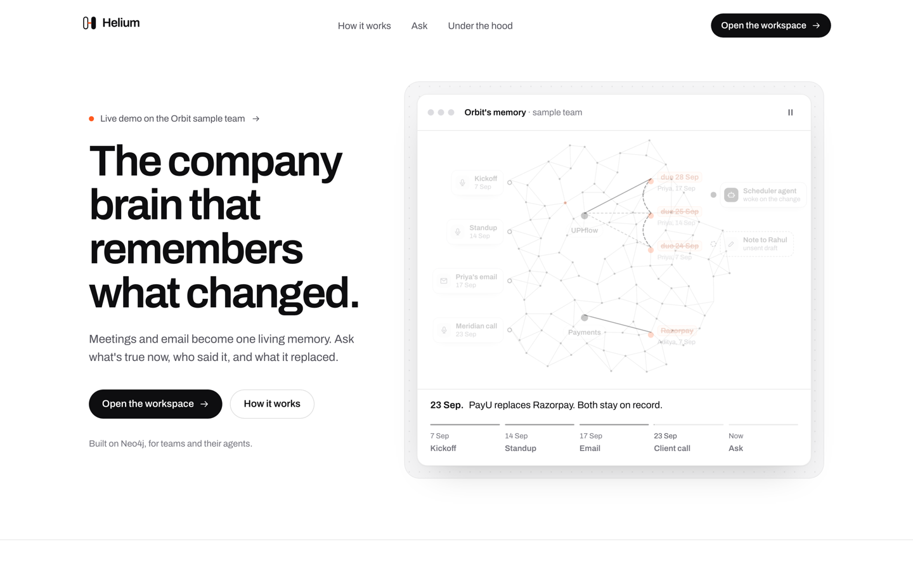
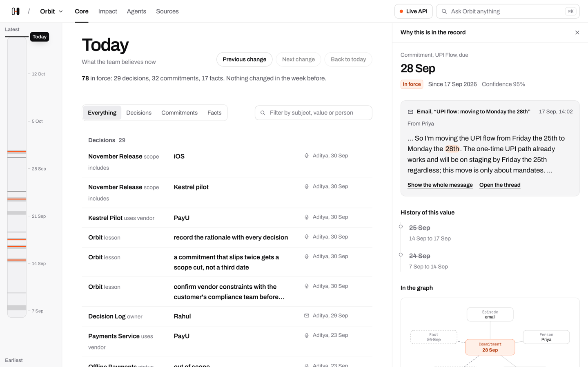

<div align="center">

# 🎈 Helium

### Memory with a trail.

**What is true now · Who said it · What it replaced**

[](https://github.com/PDGamerSG/helium/archive/refs/heads/main.zip)




</div>

Helium turns what your team says in meetings and writes in email into one memory that knows what is true now, what was true before, who said it, and what replaced it. Your agents read and write that same memory. Use it to answer "when is this due, and who said so?", to see which work a changed decision touches, or to give Cursor and VS Code your team's context.

## 💡 Why you'll like it

| | |
|---|---|
| 🕰️ **Read any day** | Drag the timeline back to a date and see what the team believed then. |
| 🧾 **Receipts on every answer** | Each value links to the meeting line or email that set it, with the speaker and the time. |
| 🔁 **Nothing overwritten** | A newer statement replaces an older one, and the older one stays readable with its date and source. |
| 🎯 **Changes show their impact** | When a decision changes, Helium lists the planned work that still depends on the old value. |
| 🤖 **Agents share one memory** | Agents wake when a fact changes, and only one agent can claim a given task. |
| 🔌 **Ask from your editor** | Cursor, VS Code, and other MCP clients can query the same memory. |
| ✋ **People decide** | Agents write follow-up drafts locally. Nothing is sent on your behalf. |

## 🚀 Three steps



1. **Bring in meetings and email.** Recorder exports, audio, and email threads become dated facts, decisions, and commitments.
2. **Ask what is true.** Ask a question, or open any value to see who said it, when, and what it replaced.
3. **Act on the change.** Review the work a changed decision touches, and let an agent draft the follow-up.

## 📥 Download

1. Download the [ZIP of this repo](https://github.com/PDGamerSG/helium/archive/refs/heads/main.zip) and unzip it, or clone it with Git.
2. Copy the example settings and start Neo4j. The compose file accepts Neo4j's **evaluation** license for the Enterprise image; read Neo4j's terms before you use it for anything else.

   ```bash
   cp .env.example .env
   docker compose up -d neo4j
   ```

3. Install the Python packages, load the three sample teams, and start the API on port 8081.

   ```bash
   uv sync --all-packages
   uv run --package helium-api python data/seed.py --tenants orbit,nimbus,quill --reset
   uv run --package helium-api uvicorn apps.api.main:app --port 8081
   ```

4. Start the workspace in a second terminal and open <http://localhost:3003>.

   ```bash
   cd apps/site
   pnpm install
   pnpm dev
   ```

Only want to look around? Run step 4 alone with `HELIUM_SOURCE=sample pnpm dev`. The workspace then reads a bundled snapshot of the Orbit sample team, and actions that write to the graph are switched off.

The seed script replays reviewed labels by default, so it needs no language model. Set `LLM_BACKEND=fake` and `EMBED_BACKEND=fake` in `.env` to skip model downloads entirely.

| Requirement | Details |
|---|---|
| Docker | Runs Neo4j Enterprise with APOC and Graph Data Science. The compose file gives Neo4j up to 2 GB of heap and 512 MB of page cache. |
| Python | 3.12 or 3.13, with [uv](https://docs.astral.sh/uv/). |
| Node.js | 20 or newer, with pnpm 10. |
| Language model | Optional for the sample data. Ollama (`gemma4:e4b`) by default; Gemini and OpenRouter are also supported. |
| Embeddings | EmbeddingGemma (ONNX), downloaded on first use. |
| Speech to text | Optional. A Sarvam API key for audio in Hindi, English, and Hinglish. |
| Not supported | Logins and per-user access on the API. Windows is not tested. No hosted version. |

## 🔍 What it does

| Stage | What happens |
|---|---|
| Ingest | Recorder exports, audio, and email (`.eml`, `.mbox`, JSON) are stored as episodes with their speakers and times. |
| Extract | Facts, decisions, and commitments are pulled from each episode and linked to the person and line that produced them. |
| Supersede | A newer value links to the value it replaces. Both keep the time they were true and the time Helium learned them. |
| Recall | Questions run hybrid vector and full-text search plus graph paths. Every answer can show the Cypher query that produced it. |
| React | Neo4j Change Data Capture wakes the Fact, FollowUp, Scheduler, Standup, and Answer agents. Task claims use compare-and-set, so one claim wins. |
| Impact | Work items planned on a superseded decision are listed. An agent can write an unsent local draft for each one. |
| Isolate | Each team gets its own Neo4j database, with access enforced by the database. |

## ⚙️ How it works

```text
 meetings, audio, email ──► ingest ──► Neo4j graph ◄──► FastAPI ◄──► workspace (Next.js)
                                        │      ▲
                          change events │      │ claims, hand-offs
                                        ▼      │
                                         agents

 Cursor, VS Code ◄──► MCP server ◄──► Neo4j graph
```

| Component | Purpose | License |
|---|---|---|
| `packages/hiveboard` | Temporal memory, task coordination, Change Data Capture, MCP server | MIT |
| `packages/ingest` | Recorder and email formats, extraction, embeddings | MIT |
| `apps/api` | FastAPI routes, agents, and background workers | MIT |
| `apps/site` | Landing page and live workspace | MIT |
| `cypher/` | Numbered graph queries and schema | MIT |
| Neo4j Enterprise, Graph Data Science | Graph database, per-team databases, access control, Change Data Capture, PageRank | Neo4j's terms (evaluation license in `docker-compose.yml`) |
| APOC | Neo4j procedure library | Apache 2.0 |
| EmbeddingGemma | Default text embeddings | Gemma Terms of Use |
| AMI Meeting Corpus | Real meeting recordings used for evaluation | CC BY 4.0 |

## 🛡️ Responsible use

Helium stores what people say and write. Tell people before you record or import their meetings and email, and follow your workplace's rules for keeping that data. Agents only draft messages; a person must send them. The API has no login yet, so keep it on a private network.

## ⚠️ Known limits

- The API has no login or team membership yet. Anyone who can reach the API can open any team.
- Extraction from real meetings is weak. On the AMI meetings, strict-match precision and recall are 0.02. On the scripted sample corpus they are 0.42 and 0.59 (Gemma 4 26B). The demo replays reviewed labels.
- Performance numbers come from one laptop: 954 mixed operations per second with 20 agents across 4 teams, and read latency of 18 ms at p50 and 43 ms at p99. There is no production deployment.
- Per-team databases, database access control, and Change Data Capture need Neo4j Enterprise.
- In the MCP server, `search` and `recall` use a simple word-overlap embedder unless you supply one, so they do not rank by meaning.
- `docker compose up` builds the earlier `apps/web` shell, not `apps/site`.
- The sample teams and their dates are synthetic and only illustrate the product.
- Tested on macOS and in Linux CI. Windows is not tested.
- The interface is in English only.

## 🛠️ Development

Prerequisites: Git, Docker, Python 3.12 or 3.13 with uv, and Node.js 20 or newer with pnpm.

```bash
git clone https://github.com/PDGamerSG/helium.git
cd helium
uv sync --all-packages
```

Run the Python tests and lint checks:

```bash
uv run pytest packages/hiveboard/tests packages/ingest/tests apps/api/tests -q
uv run ruff check packages apps data scripts
```

Check and build the workspace:

```bash
cd apps/site
pnpm install
pnpm typecheck && pnpm lint && pnpm build
```

| Folder | Contents |
|---|---|
| `cypher/` | Numbered graph queries and schema |
| `packages/hiveboard/` | Neo4j memory, coordination, Change Data Capture, MCP server |
| `packages/ingest/` | Recorder and email contracts, extraction, embeddings |
| `apps/api/` | FastAPI routes, agents, and workers |
| `apps/site/` | Landing page and live workspace (see [`apps/site/README.md`](apps/site/README.md)) |
| `apps/web/` | Earlier Next.js workspace shell |
| `data/` | Synthetic sample teams, gold labels, and evaluation fixtures |
| `docs/` | Architecture, API contracts, and demo runbooks |
| `scripts/` | Demo and brand checks |

More detail: the demo runbook in [`docs/helium-demo.md`](docs/helium-demo.md), the HTTP API in [`docs/contracts/http-api.md`](docs/contracts/http-api.md), and MCP setup in [`docs/mcp.md`](docs/mcp.md).

## 📄 License

[MIT](LICENSE). Helium builds on the `helium-neo4j` prototype; see [`docs/UPSTREAM.md`](docs/UPSTREAM.md) for attribution.
