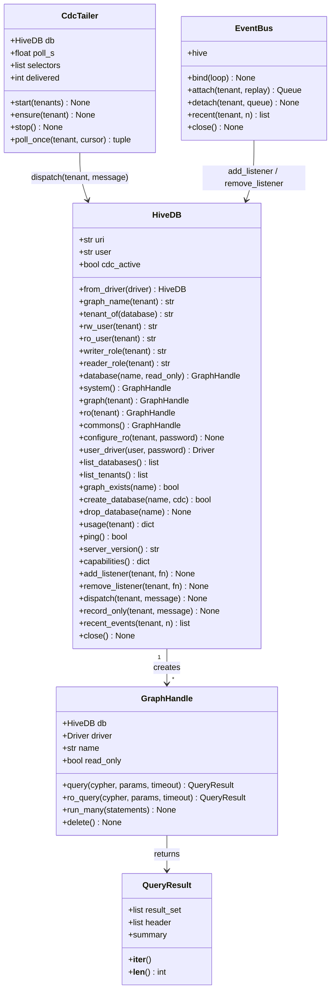
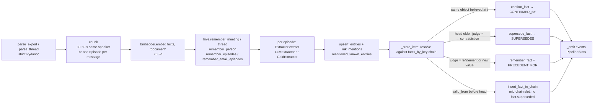

# Low-level design

Module-by-module detail of Helium as the code stands: public functions and their signatures, which numbered
Cypher file each one loads, transaction mode and timeout, the events it publishes, and the error paths. The
layers, data flow and Neo4j feature map are in [HLD.md](HLD.md); diagrams in [architecture.md](architecture.md);
every label, property, index and file contract in [data-schema.md](data-schema.md); requirements in
[SRS.md](SRS.md); scenarios in [use-cases.md](use-cases.md). HTTP payloads are specified in
[../contracts/http-api.md](../contracts/http-api.md) and the substrate API in
[../contracts/hiveboard-api.md](../contracts/hiveboard-api.md).

Conventions used below: `tenant` is always the slug (`orbit`), never the database name; every substrate function
takes `db: HiveDB` first and the adapter drops that argument; "read, 3 s" means `db.ro(tenant).ro_query(...,
timeout=3000)` (a managed read transaction, `RO_TIMEOUT_MS = 3000`, server-side timeout, writes refused);
"write" means `db.graph(tenant).query(...)` (a managed write transaction, no timeout, admin driver). `CypherRows`
is a `list` subclass carrying `.cypher`, the query text that produced it, so routes can show it in the Why panel.

## 1. `packages/hiveboard/hiveboard/`

### 1.1 Class diagram

`EventBus` lives in `apps/api/bus.py`; it is drawn here because it is the only consumer of `HiveDB.add_listener`.



### 1.2 `db.py` (connection, naming, capabilities, in-process bus)

| Function | What it does | Mode |
|---|---|---|
| `HiveDB(uri=None, user=None, password=None, *, admin_user=None, admin_password=None, max_pool=100)` | One admin `neo4j.Driver` (`notifications_min_severity="OFF"`), a dict of per-tenant read-only drivers (pool 20) keyed by slug, a listener table and a 500-event replay deque per tenant. Env fallbacks `NEO4J_URI`, `NEO4J_USER`, `NEO4J_PASSWORD`. | |
| `HiveDB.from_driver(driver) -> HiveDB` | Wraps a foreign driver (Aura mirror target); no tenancy. | |
| `graph_name(tenant) -> str` / `tenant_of(database) -> str \| None` | `team-<slug>` with `_` folded to `-` (Neo4j names forbid underscores); the inverse returns None for `commons`, `system` and `-snap-` copies. | |
| `rw_user`, `ro_user`, `writer_role`, `reader_role` | `team_<slug>_rw`, `team_<slug>_ro`, `team_<slug>_writer`, `team_<slug>_reader`. | |
| `database(name, read_only=False)`, `system()`, `graph(tenant)`, `commons()` | Handles on the admin driver. | |
| `ro(tenant) -> GraphHandle` | The tenant's `_ro` user driver when `configure_ro` registered a password, else the admin driver in `READ_ACCESS`; either way `read_only=True`. | read |
| `configure_ro(tenant, password \| None)` | Registers or forgets the reader password; closes the old driver. | |
| `user_driver(user, password) -> Driver` | Throwaway driver (pool 2) for the ACL probe; caller closes. | |
| `list_databases()`, `list_graphs()`, `graph_exists(name)`, `list_tenants()` | `SHOW DATABASES ... WHERE type = 'standard'` on `system`. | write tx on `system` |
| `create_database(name, *, cdc=False) -> bool` | `CREATE DATABASE `name` IF NOT EXISTS [OPTIONS {txLogEnrichment: 'FULL'}] WAIT`; the option only when `cdc` and `capabilities()["cdc"]`. | |
| `drop_database(name)` | `DROP DATABASE ... IF EXISTS DESTROY DATA WAIT`. | |
| `usage(tenant) -> dict` | `apoc.meta.stats` (3 s) or plain `count(n)` / `count(r)` when APOC is absent; `total_mb` is always 0.0. | read, 3 s |
| `ping() -> bool` | `verify_connectivity`, swallowing `ServiceUnavailable`, `Neo4jError`, `OSError`. | |
| `capabilities() -> dict` | Probed once: `dbms.components` (edition, version, `multi_database` = enterprise) and `SHOW PROCEDURES` (`gds` = `gds.pageRank.stream` and `gds.wcc.stream`, `apoc` = `apoc.meta.stats`, `cdc` = `db.cdc.query` and enterprise). | |
| `add_listener`, `remove_listener`, `dispatch`, `record_only`, `recent_events` | The in-process bus; `dispatch` appends to history then calls every listener, logging (not raising) listener failures. | |
| `GraphHandle.query(cypher, params=None, timeout=None)` | `session.execute_write` (or a read when the handle is read-only). | write |
| `GraphHandle.ro_query(cypher, params=None, timeout=None)` | `session.execute_read` with `unit_of_work(timeout=ms/1000)` when a timeout is given; a write clause raises `neo4j.exceptions.ClientError`. | read |
| `GraphHandle.run_many(statements)` | Several statements in one write transaction (schema). | write |

`QueryError` is an alias of `neo4j.exceptions.Neo4jError`; `ClientError` is re-exported.

### 1.3 `queries.py` (loader) and `schema.py`

| Function | What it does |
|---|---|
| `cypher_dirs() -> list[Path]` | `$HIVEBOARD_CYPHER_DIR`, then the monorepo `cypher/`, then `hiveboard/cypher/` bundled into the wheel by hatch. |
| `cypher_path(name) -> Path` (cached) | Resolves `claim_task` or `20_claim_task`; `FileNotFoundError` otherwise. |
| `load_cypher(name) -> str` (cached) | File text with `//` comment lines removed. Every substrate function below calls this. |
| `schema_statements() -> list[str]` | Each non-comment line of `00_schema.cypher` is one statement. |
| `list_queries() -> list[str]` | Stems of every `NN_*.cypher` visible to the loader. |
| `constraint_statements() -> list[str]` | `CREATE CONSTRAINT <label>_id IF NOT EXISTS FOR (n:<Label>) REQUIRE n.id IS UNIQUE` for the 17 `UNIQUE_ID_LABELS`. |
| `ensure_schema(db, tenant) -> dict[str, int]` | `create_database(graph_name, cdc=True)` then `apply_schema`. |
| `ensure_commons_schema(db) -> dict[str, int]` | Same on `commons`. |
| `apply_schema(db, graph) -> dict[str, int]` | `SHOW INDEXES` / `SHOW CONSTRAINTS` to count existing vs created, then **one** `run_many` of the 24 index statements plus 17 constraints, then `CALL db.awaitIndexes(120)`. Returns `{indexes_created, indexes_existing, constraints_created, constraints_existing}`. |

Constants: `VECTOR_INDEXES = {Episode: episode_embedding, Fact: fact_embedding, Skill: skill_embedding, Entity: entity_embedding}`, `FULLTEXT_INDEXES = {Episode: episode_text, Fact: fact_text, Decision: decision_text}`.

### 1.4 `tenancy.py`

| Function | What it does | Cypher | Mode |
|---|---|---|---|
| `validate_slug(tenant) -> str` | `^[a-z0-9][a-z0-9_]{0,57}$` else `ValueError`. | | |
| `create_tenant(db, tenant, display_name, password_rw, password_ro) -> dict` | `ensure_schema` + `ensure_commons_schema`, binds both users (resetting passwords), `configure_ro`, registry row, returns `acl_rules(...)` plus `slug`, `display_name`, `schema` counts. Idempotent. | `72_upsert_tenant` | admin commands on `system`; write on `commons` |
| `ensure_tenant_access(db, tenant, password_rw, password_ro)` | Restores missing users/roles/grants with `reset_password=False`; `NotFound` when the database does not exist. | | |
| `delete_tenant(db, tenant)` | Drops `team-<slug>` and every `team-<slug>-snap-*`, both users, both roles, the registry and snapshot rows. | `73_delete_tenant_meta` | |
| `acl_rules(db, tenant) -> dict` | `GRANT ROLE ...` lines plus `SHOW ROLE <role> PRIVILEGES AS COMMANDS` for both roles; `Neo4jError` on the SHOW yields an empty list. Returns `{graph, rw_user, ro_user, rules, isolation}`. | | |
| `list_registered_tenants(db) -> list[dict]` | Registry rows; `[]` when `commons` does not exist. | `74_list_tenants` | read on `commons`, 3 s |
| `copy_database(db, source, target, batch=500) -> dict` | Creates `target`, applies the schema, adds a temporary `copy_src` index on `_Copy._src`, copies nodes (`SET n:$(r.labels)`) and relationships (`[rel:$(r.type)]`) in UNWIND batches, removes the `_Copy` label and `_src`, drops the index. | inline Cypher | read on source, write on target |
| `snapshot(db, tenant, label) -> str` | `copy_database` into `team-<slug>-snap-<ms>` and a Snapshot row; returns the copy's name. | `70_record_snapshot` | |
| `list_snapshots(db, tenant) -> list[dict]` | `[{id, name, label, taken_at, exists}]`, `exists` checked against `SHOW DATABASES`. | `71_list_snapshots` | read on `commons`, 3 s |

`_bind_user` creates the user with `SET HOME DATABASE` = the tenant database (so the built-in PUBLIC role's `ACCESS ON HOME DATABASE` cannot reach `neo4j`), then the role, `GRANT ROLE`, and the privilege templates on `[tenant db, commons]`: readers `GRANT ACCESS ON DATABASE` + `GRANT MATCH {*} ON GRAPH`; writers add `GRANT WRITE ON GRAPH` + `GRANT NAME MANAGEMENT ON DATABASE`.

### 1.5 `memory.py`

| Function | What it does | Cypher | Mode | Publishes |
|---|---|---|---|---|
| `remember_person(db, tenant, person) -> str` / `remember_people(db, tenant, people) -> list[str]` | Upsert by id, default id `per_<slug(name)>`. | `01_upsert_person` | write | |
| `remember_meeting(db, tenant, meeting) -> str` | Upsert; timestamps through `to_ms`. | `02_upsert_meeting` | write | |
| `remember_thread(db, tenant, thread) -> str` | Upsert EmailThread. | `03_upsert_thread` | write | |
| `remember_episodes(db, tenant, meeting_id, episodes) -> int` | Sorts by `seq`, finds the predecessor of the batch, fills `prev_id`, writes in batches of 200. `NotFound` when the container does not exist (zero rows). | `16_last_episode`, `10_ingest_episode` | write | `episode.ingested {container_id, count, source_kind}` |
| `remember_email_episodes(db, tenant, thread_id, episodes) -> int` | Same with `source_kind='email'`, `message_id` defaulting to the episode id. | same | write | same |
| `upsert_entities(db, tenant, entities) -> dict[str, str]` / `remember_entities(...) -> int` | MERGE on `name`; returns `{name: effective id}`. | `04_upsert_entity` | write | |
| `link_mentions(db, tenant, episode_id, entity_ids) -> int` | MENTIONS plus pairwise CO_MENTIONED (weight++). | `05_link_mentions` | write | |
| `fact_key(subject, predicate) -> str` | `lower("subject\|predicate")`. | | | |
| `remember_fact(db, tenant, fact, supersede=False) -> dict` | Reads active facts with the same key (`14_active_facts`, via `graph.query`, i.e. a write-mode transaction on the admin handle); identical object and no explicit id → `{existing: True}`; different objects → `conflicts`, or expired + SUPERSEDES when `supersede=True`. Returns `{id, superseded, conflicts, existing}`. | `14_active_facts`, `11_ingest_fact`, `12_supersede_fact` | write | `fact.created`, `commitment.created` (kind commitment), `fact.superseded {new_id, old_ids, key, kind, object}`, `commitment.updated` |
| `supersede_fact(db, tenant, old_id, new_fact) -> dict` | `NotFound` if `old_id` missing, `Conflict` if not active; ingests the new fact, links it. | `17_fact_status`, `11_ingest_fact`, `12_supersede_fact` | write | same as above |
| `retract_fact(db, tenant, fact_id, reason)` | `status='retracted'`; `NotFound` on zero rows. | `13_retract_fact` | write | |
| `active_facts(db, tenant, entity_id=None, key=None, limit=200) -> CypherRows` | Rows `{...fact props, entities, speaker, episode_id, meeting \| thread}`. | `14_active_facts` | read, 3 s | |
| `belief_at(db, tenant, t, entity_id=None, known_by=None) -> CypherRows` | Valid-time filter plus optional transaction-time filter. | `31_belief_at_time` | read, 3 s | |
| `why(db, tenant, node_id) -> dict` | `{node, speaker, meeting, thread, episode, source, entities, history, superseded_by, supersedes, cypher, subgraph}`; chains sorted newest first in Python. `NotFound` on zero rows. | `32_why_path` | read, 3 s | |
| `recall(db, tenant, query_embedding, k=8, now=None, label="Fact") -> dict` | `n = max(20, 3k)` candidates; `{items[{node, id, distance, similarity, rank, entities, neighbours}], cypher, subgraph, label, k, now, index}`. `ValueError` for a label without a vector index. | `30_recall_hybrid` | read, 3 s | |
| `sanitize_fulltext(text) -> str` | Keeps `[A-Za-z0-9]` tokens, drops `AND`/`OR`/`NOT`, joins with ` OR `. | | | |
| `fulltext(db, tenant, text, label="Episode", k=10) -> CypherRows` | Lucene lookup; empty sanitised text returns `[]` without a query. | `15_fulltext` | read, 3 s | |

`fact_props(f)` pads `valid_to`, `expired_at`, `due_at` with `None` (Neo4j drops NULL properties) so records keep a stable shape.

### 1.6 `board.py`

| Function | What it does | Cypher | Mode | Publishes |
|---|---|---|---|---|
| `register_agent(db, tenant, agent_id, name, capabilities, model)` | Upsert Agent + HAS Capability. | `25_register_agent` | write | |
| `submit_task(db, tenant, kind, payload, requires, about_ids=(), priority=5) -> str` | `task_<ulid>`, version 0, payload as JSON (orjson). | `26_submit_task` | write | `task.submitted {task_id, kind, requires, about, priority}` |
| `claim(db, tenant, task_id, agent_id, expected_version) -> int \| None` | Compare-and-set; `None` on zero rows (lost or not submitted). | `20_claim_task` | write | `task.claimed {task_id, agent_id, version}` |
| `next_open_task(db, tenant, agent_id) -> dict \| None` | Oldest `submitted` task whose REQUIRES ⊆ HAS and unaddressed or addressed to this agent. | `27_next_open_task` | read, 3 s | |
| `handoff(db, tenant, task_id, from_agent, to_agent, expected_version, summary, subgraph_ids) -> int \| None` | Back to `submitted` with `owner_agent = to`. | `21_handoff_task` | write | `task.handed_off {task_id, from, to, version, summary, subgraph_ids}` |
| `complete(db, tenant, task_id, agent_id, artifact=None)` | Owner only, from `working` or `input_required`; optional PRODUCED Artifact `{id, kind, uri, text}`. `NotFound` on zero rows. | `22_complete_task` | write | `task.completed {task_id, agent_id, artifact, version}` |
| `fail(db, tenant, task_id, agent_id, reason)` / `need_input(db, tenant, task_id, agent_id, question)` | Owner moves the task; `NotFound` otherwise. | `24_set_task_state` | write | `task.failed {task_id, agent_id, reason, version}` / `task.input_required {..., question, version}` |
| `list_tasks(db, tenant, status=None, limit=50) -> CypherRows` | Newest first, payload decoded, `_lock` hidden (`props` drops `_`-prefixed keys). | `28_list_tasks` | read, 3 s | |
| `list_agents(db, tenant) -> CypherRows` | Capabilities plus derived `state` (`working` / `idle`). | `29_list_agents` | read, 3 s | |
| `task_trace(db, tenant, task_id) -> dict` | `{task, events, about, cypher}`; claims, hand-offs, artifacts, skills and the terminal state in time order; `_present` drops the all-null record that `collect()` over an empty OPTIONAL MATCH yields. | `23_task_trace` | read, 3 s | |

`TASK_STATES = ("submitted", "working", "input_required", "completed", "failed")`.

### 1.7 `skills.py`

| Function | What it does | Cypher | Mode | Publishes |
|---|---|---|---|---|
| `learn_skill(db, tenant, goal, steps, learned_from, embedding, version=1) -> str` | `skl_<ulid>`; steps get `stp_<ulid>` ids and `order` defaulting to their index. | `42_learn_skill` | write | `skill.learned {skill_id, goal, steps, learned_from}` |
| `retrieve_skill(db, tenant, goal_embedding, k=3) -> CypherRows` | KNN over `skill_embedding`, `n = max(10, 4k)`, ordered by `success_rate` then distance. | `40_skill_retrieve` | read, 3 s | |
| `record_outcome(db, tenant, skill_id, agent_id, ok, task_id=None) -> dict` | Running mean; RAN and USED edges; `NotFound` on zero rows. | `41_skill_outcome` | write | `skill.ran {skill_id, agent_id, ok, task_id, runs, success_rate}` |
| `deprecate_skill(db, tenant, old_id, new_id_)` | DEPRECATED_BY; `NotFound` on zero rows. | `43_deprecate_skill` | write | |
| `skill_pagerank(db, tenant) -> CypherRows` | GDS when `capabilities()["gds"]`, 9 s timeout; on `Neo4jError` (projection fails on a tenant without the labels yet) falls back to `62_`. | `60_pagerank_skills` → `62_pagerank_skills_cypher` | read, 9 s / 3 s | |
| `get_skill(db, tenant, skill_id) -> dict` | With steps and `learned_from` ids. | `44_export_skill` | read, 3 s | |
| `list_skills(db, tenant, status=None) -> CypherRows` | Newest first. | `46_list_skills` | read, 3 s | |
| `publish_to_commons(db, tenant, skill_id) -> str` | Copies skill and steps (ids suffixed `@<tenant>`) into `commons`; returns `<skill_id>@<tenant>`. | `44_export_skill`, `45_import_skill_commons` | write (tenant then `commons`) | |

### 1.8 `analytics.py`

| Function | Cypher | Returns |
|---|---|---|
| `owners(db, tenant, entity_name) -> CypherRows` | `54_owners` | `[{fact_id, person: {id, name}}]` |
| `who_knows(db, tenant, entity_name) -> CypherRows` | `50_who_knows` | `[{person, mentions, last_at, via}]` |
| `open_commitments(db, tenant, person_id=None) -> CypherRows` | `51_open_commitments` | commitment props plus `owner`, `speaker`, `entities` |
| `contradictions(db, tenant) -> CypherRows` | `52_contradictions` | `[{key, facts: [a, b]}]` |
| `entity_clusters(db, tenant) -> CypherRows` | `61_wcc_entities` → `63_wcc_entities_cypher` on `Neo4jError` or no GDS | `[{component, entities}]` |
| `stale_decisions(db, tenant, older_than_ms) -> CypherRows` | `53_stale_decisions` (`$cutoff = now - older_than_ms`) | decision props plus `decider`, `entities`, `age_ms` |

All read, 3 s (GDS variants 9 s). `owners` is not re-exported from `hiveboard/__init__.py`; the adapter reaches it as `hiveboard.analytics.owners`.

### 1.9 `impact.py`

| Function | What it does | Cypher | Mode |
|---|---|---|---|
| `import_manifest(db, tenant, manifest) -> int` | 1–200 distinct items; the query validates every `baseline_fact_id` and `owner_id` before writing, so an unresolved reference yields 0 imported and `ValueError("manifest reference not found in this tenant")`. | `80_import_work_manifest` | write |
| `work_impacts(db, tenant) -> CypherRows` | `[{item, baseline, owner, document, candidates[{fact, via}]}]`; candidates without a fact id are dropped. | `81_work_impacts` | read, 3 s |
| `save_draft(db, tenant, draft) -> dict \| None` | Re-validates work item, owner, document and the single active head with a SUPERSEDES path to the baseline inside the write; `None` when any check fails. | `82_save_impact_draft` | write |
| `list_drafts(db, tenant) -> list[dict]` | Draft payloads newest first. | `83_impact_drafts` | read, 3 s |

### 1.10 `graphrag.py`

| Function | What it does |
|---|---|
| `CallableEmbedder(fn)` | Adapts `text -> list[float]` to `neo4j_graphrag.embeddings.base.Embedder.embed_query`. |
| `fact_retriever(db, tenant, embed) -> HybridCypherRetriever` | Bound to `db.driver`, `fact_embedding`, `fact_text`, `RETRIEVAL_QUERY` (entities, speaker, episode, container per hit; `status='active'` only), `neo4j_database = team-<slug>`. |
| `search_cypher(ranker="naive") -> str` | The Cypher the package generates (`get_search_query(SearchType.HYBRID, ...)`), for the Why panel. |
| `search(db, tenant, embed, text, k=8, ranker="naive") -> dict` | Vector side embeds the raw text; full-text side gets `sanitize_fulltext(text) or text`. Returns `{items, cypher, retriever, indexes, ranker, k}` with `meeting`/`thread` split from the container's labels. |

Uses the admin driver (not the tenant's reader) because the retriever owns its sessions.

### 1.11 `events.py` and `cdc.py`

`EVENT_NAMES` (13): `episode.ingested`, `fact.created`, `fact.superseded`, `commitment.created`, `commitment.updated`, `task.submitted`, `task.claimed`, `task.handed_off`, `task.completed`, `task.failed`, `task.input_required`, `skill.learned`, `skill.ran`.

| Function | What it does |
|---|---|
| `channel(tenant) -> str` | `team_<slug>:events` (a logical name only). |
| `publish(db, tenant, event, payload)` | Message `{event, payload, ts, source: 'writer'}`; when `db.cdc_active` it only `record_only`s (the tailer delivers), else `dispatch`. Synchronous on the caller's thread. |
| `subscribe(db, tenant, idle_timeout=None) -> Iterator` | Blocking iterator through a `queue.Queue`; listener attached before return; stops after `idle_timeout` seconds of silence. |
| `asubscribe(db, tenant) -> AsyncIterator` | Same through `loop.call_soon_threadsafe`. |
| `translate_tx(records, lookup_element=None) -> list[tuple[str, dict]]` | Pure function: CDC records of one transaction (sorted by `seq`) → bus events. Fact `c` → `fact.created` (+ `commitment.created`); SUPERSEDES `c` → `fact.superseded {new_id, old_ids, key, kind, subject, predicate, object, old_object, due_at, head_changed: True}` with `old_object` from the old node's `before` state (+ `commitment.updated`); HAS_EPISODE `c` grouped per container → `episode.ingested`; Task `c` → `task.submitted`; Task `u` with a status change → `task.claimed` / `task.handed_off` (joined with the HANDED_OFF rel of the same tx) / `task.completed` (joined with PRODUCED) / `task.failed` / `task.input_required`; Skill `c` → `skill.learned`; RAN `c` → `skill.ran`. |
| `CdcTailer(db, poll_s=0.5, selectors=SELECTORS)` | `start(tenants)` sets `db.cdc_active = True` and spawns one daemon thread per tenant from `db.cdc.current()` (nothing replayed); `ensure(tenant)` adds one later; `stop()` joins and clears `cdc_active`. |
| `CdcTailer.poll_once(tenant, cursor) -> (cursor, delivered)` | `CALL db.cdc.query($from, $selectors)` (read, 10 s) on `database(graph_name, read_only=True)` (admin driver), groups by `txId`, dispatches `{event, payload, ts, source: 'cdc', tx, user: metadata.executingUser}`. |

`SELECTORS` cover nodes `Fact`, `Task`, `Episode`, `Skill`, `Artifact` and relationships `SUPERSEDES`, `HANDED_OFF`, `HAS_EPISODE`, `RAN`, `USED`, `STEP`, `LEARNED_FROM`, `PRODUCED`.

### 1.12 `mcp_server.py`

`build_server(db=None, embedder=None, name="hiveboard")` returns a `FastMCP` (mcp 1.x) or `MCPServer` (mcp 2.x) with eight tools; `main()` serves over stdio (`uv run --package hiveboard python -m hiveboard.mcp_server`, script `hiveboard-mcp`). Without an injected embedder the hashed `fake_embedding` is used.

| Tool | Parameters | Calls | Returns |
|---|---|---|---|
| `recall` | `tenant, query_text, k=8, label="Fact"` | `memory.recall` | `{items, cypher, subgraph, ...}` |
| `search` | `tenant, query_text, k=8` | `graphrag.search` | `{items, cypher, retriever, indexes, ranker, k}` |
| `why` | `tenant, node_id` | `memory.why` | the Why record |
| `belief_at` | `tenant, t_ms, entity_id=None` | `memory.belief_at` | `{t, facts, cypher}` |
| `list_tasks` | `tenant, status=None, limit=50` | `board.list_tasks` | `{tasks, cypher}` |
| `claim` | `tenant, task_id, agent_id, expected_version` | `board.claim` | `{task_id, agent_id, version, won}` |
| `handoff` | `tenant, task_id, from_agent, to_agent, expected_version, summary, subgraph_ids` | `board.handoff` | `{task_id, to_agent, version, ok}` |
| `open_commitments` | `tenant, person_id=None` | `analytics.open_commitments` | `{commitments, cypher}` |

Reads use `HiveDB.ro` (3 s); `claim` and `handoff` write through the admin handle. Writes made here reach the API's agents through CDC when the API runs with `HELIUM_EVENTS=cdc`.

### 1.13 Helpers: `records.py`, `ids.py`, `temporal.py`, `embed.py`, `errors.py`, `bench/`

- `records.py`: `CypherRows`, `primary_label(labels)` (Commitment/Decision beat Fact), `props(x, keep_embedding=False)` (drops `_`-prefixed keys, replaces `embedding` with `has_embedding`), `brief(x, *fields)`, `compact(record)`, `graph_node(x) -> {id, label, labels, props}`, `graph_edge(...)`, `Subgraph.add_node/add_edge/add_relationship/to_dict`, `row_value(value)` (driver Node/Relationship/Path → plain values).
- `ids.py`: `ulid()` (48-bit ms + 80 random bits, Crockford base32), `new_id(prefix)`, `slugify(text)`.
- `temporal.py`: `now_ms()`, `iso_to_ms(s)`, `ms_to_iso(ms)`, `to_ms(value)` (bool raises `TypeError`).
- `embed.py`: `fake_embedding(text, dim=768)` hashed bag of tokens and bigrams, L2-normalised; used by tests, the bench and the MCP server.
- `errors.py`: `HiveError`, `NotFound`, `Conflict`.
- `bench/harness.py` (`hiveboard-bench`): N agents × M tenants, 80 % reads (`recall`, `active_facts`, `list_tasks`), 20 % writes (`remember_fact`, `claim`, `complete`), percentiles per class, CAS contention test; writes `docs/bench/<engine>-<target>-<agents>x<tenants>-<ts>.json`.

## 2. Cypher catalogue (`cypher/`)

Every file starts with a `//` header naming its parameters; `load_cypher` strips those lines. Nodes are returned as map projections without `embedding` wherever a client will see them.

| # | Name | Purpose | Parameters | Returns |
|---|---|---|---|---|
| 00 | `schema` | 17 range, 3 full-text, 4 vector indexes (one statement per line) | | |
| 01 | `upsert_person` | MERGE Person by id; `coalesce` keeps old values | `$rows [{id, name, role?, email?}]` | `id` |
| 02 | `upsert_meeting` | MERGE Meeting | `$rows [{id, title, started_at, ended_at?, source_uri?}]` | `id` |
| 03 | `upsert_thread` | MERGE EmailThread | `$rows [{id, subject, started_at}]` | `id` |
| 04 | `upsert_entity` | MERGE Entity on `name`; id only on create | `$now, $rows [{id, name, type?, embedding?}]` | `name, id` |
| 05 | `link_mentions` | MENTIONS + pairwise CO_MENTIONED (`weight`) | `$episode_id, $entity_ids` | `mentions` |
| 10 | `ingest_episode` | MERGE Episodes under a Meeting/EmailThread with HAS_EPISODE, SPOKEN_BY+ATTENDED or SENT_BY, SENT_TO{cc}, REPLIES_TO, NEXT | `$container_id, $now, $rows [{id, seq, text, t_start?, t_end?, t_occurred, source_kind, speaker_id?, sender_id?, recipients?, in_reply_to_id?, prev_id?, message_id?, embedding?}]` | `episodes` |
| 11 | `ingest_fact` | MERGE Fact (+:Decision/:Commitment), DERIVED_FROM, DECIDED_IN, STATED_BY, MADE_BY, OWNED_BY, ABOUT; `valid_from` defaults to the episode's `t_occurred` then `$now` | `$now, $rows [{id, kind, subject, predicate, object, key, text, confidence, valid_from?, due_at?, speaker_id?, owner_id?, episode_id?, entity_ids?, embedding?}]` | `facts` |
| 12 | `supersede_fact` | Expire active olds (`valid_to = new.valid_from`, `expired_at = $now`, `status = superseded`) and MERGE SUPERSEDES{at} | `$new_id, $old_ids, $now` | `superseded` (ids) |
| 13 | `retract_fact` | `status = retracted`, `retract_reason` | `$id, $reason, $now` | `id` |
| 14 | `active_facts` | ACTIVE facts by key and/or entity with speaker, entities, episode, container | `$entity, $key, $limit` | `f, entities, speaker, episode_id, container` |
| 15 | `fulltext` | `db.index.fulltext.queryNodes` | `$index, $q, $k` | `node, score` |
| 16 | `last_episode` | Predecessor of an incoming batch | `$container_id, $before_seq` | `id, seq` |
| 17 | `fact_status` | Existence/status check | `$id` | `id, status, key, object` |
| 20 | `claim_task` | Compare-and-set claim (lock-then-check) | `$id, $v, $agent, $now` | `version` (0 rows = lost) |
| 21 | `handoff_task` | Same shape; back to `submitted` addressed to `$to`, HANDED_OFF{at, from_agent, summary, subgraph_ids} | `$id, $from, $to, $v, $now, $summary, $ids` | `version` |
| 22 | `complete_task` | Owner completes from working/input_required; optional Artifact + PRODUCED | `$id, $agent, $now, $artifact` | `version` |
| 23 | `task_trace` | Claims, hand-offs, artifacts, skills, about ids | `$id` | `t, claims, handoffs, artifacts, skills, about` |
| 24 | `set_task_state` | Owner → failed (`failure_reason`) or input_required (`question`) | `$id, $agent, $status, $note, $now` | `version` |
| 25 | `register_agent` | MERGE Agent + HAS Capability | `$id, $name, $model, $caps, $now` | `id` |
| 26 | `submit_task` | CREATE Task (submitted, version 0) + REQUIRES + ABOUT (Fact/Episode/Entity/Person/Meeting/EmailThread) | `$id, $kind, $payload, $requires, $about_ids, $priority, $now` | `id` |
| 27 | `next_open_task` | Oldest submitted task with REQUIRES ⊆ HAS, unaddressed or addressed to the agent | `$agent` | `t, reqs` |
| 28 | `list_tasks` | Newest first with requires and about | `$status, $limit` | `t, requires, about` |
| 29 | `list_agents` | Agents, capabilities, working count | none | `a, capabilities, working` |
| 30 | `recall_hybrid` | Vector KNN → 1-hop via shared entities → recency × importance × similarity | `$index, $q, $n, $k, $now` | `f, distance, entities, neighbours, rank` |
| 31 | `belief_at_time` | `valid_from <= t < valid_to`, not retracted, optional `created_at <= known_by` | `$t, $entity, $known_by` | `f, entities, speaker` |
| 32 | `why_path` | Episode, speaker (SPOKEN_BY / SENT_BY / STATED_BY), container, entities, SUPERSEDES chains ≤ 10 hops both ways | `$id` | `f, ep, speaker, m, th, entities, older, newer` |
| 40 | `skill_retrieve` | KNN over `skill_embedding`, active only, with steps | `$goal, $n, $k` | `s, distance, steps` |
| 41 | `skill_outcome` | `runs += 1`, running-mean `success_rate`, RAN{at, outcome}, USED | `$id, $agent, $ok, $outcome, $task_id, $now` | `s` |
| 42 | `learn_skill` | CREATE Skill, Steps (STEP{order}), LEARNED_FROM (Episode/Meeting/Task/EmailThread) | `$id, $goal, $version, $embedding, $steps, $learned_from, $now` | `id` |
| 43 | `deprecate_skill` | `status = deprecated`, DEPRECATED_BY | `$old_id, $new_id, $now` | `id` |
| 44 | `export_skill` | Skill with steps and `learned_from` ids | `$id` | `s, steps, learned_from` |
| 45 | `import_skill_commons` | MERGE published Skill in `commons`, replace its Steps | `$id, $goal, $version, $origin_tenant, $origin_id, $runs, $success_rate, $embedding, $steps, $now` | `id` |
| 46 | `list_skills` | All skills (optional status) with steps and provenance | `$status` | `s, steps, learned_from` |
| 50 | `who_knows` | People ranked by episodes mentioning the entity (SPOKEN_BY/SENT_BY/SENT_TO) | `$name` | `id, name, mentions, last_at, via` |
| 51 | `open_commitments` | Active commitments; an unambiguous `owner` fact on the same subject overrides OWNED_BY | `$person` | `c, owner, speaker, entities` |
| 52 | `contradictions` | Active facts sharing a key with different objects | none | `key, a, b` |
| 53 | `stale_decisions` | Active decisions decided before `$cutoff` | `$cutoff` | `d, decider, entities` |
| 54 | `owners` | Explicit `owner` assignments resolved to one Person (id, name or email), else commitment OWNED_BY | `$name` | `fact_id, person_id, person_name` |
| 60 | `pagerank_skills` | GDS: project `['Task','Skill']` with `'*'`, `gds.pageRank.stream`, drop; fresh graph name per call | none | `id, goal, runs, success_rate, score` |
| 61 | `wcc_entities` | GDS: project `Entity` undirected `'*'`, `gds.wcc.stream`, drop | none | `component, entities` |
| 62 | `pagerank_skills_cypher` | Fallback: `0.15 + 0.85 × uses/total` | none | same as 60 |
| 63 | `wcc_entities_cypher` | Fallback: component = min id reachable over `CO_MENTIONED*0..` | none | same as 61 |
| 70 | `record_snapshot` | MERGE Snapshot in `commons` | `$id, $tenant, $graph_name, $label, $now` | `name` |
| 71 | `list_snapshots` | Newest first | `$tenant` | `id, name, label, taken_at` |
| 72 | `upsert_tenant` | MERGE Tenant registry row | `$slug, $display_name, $graph, $rw_user, $ro_user, $now` | `slug` |
| 73 | `delete_tenant_meta` | DELETE Tenant and Snapshot rows | `$slug` | `deleted` |
| 74 | `list_tenants` | Registry rows | none | `slug, display_name, graph, rw_user, ro_user, created_at` |
| 80 | `import_work_manifest` | Validate all baselines/owners first (`all(...)` over the collected rows), MERGE Document and WorkItems, replace DEPENDS_ON/OWNED_BY/DOCUMENTED_IN | `$items, $document` | `imported` |
| 81 | `work_impacts` | Explicit dependencies only; active facts with the baseline's key and the `SUPERSEDES*0..24` path | none | `item, baseline, owner, document, candidates` |
| 82 | `save_impact_draft` | Re-check open item, owner, document, exactly one active head ≠ baseline with a path; MERGE FollowUpDraft | `$work_item_id, $baseline_fact_id, $owner_id, $document_id, $current_fact_id, $id, $payload, $created_at` | `draft.payload` |
| 83 | `impact_drafts` | Drafts newest first, limit 200 | none | `draft.payload` |

### 2.1 Compare-and-set claim (`20_claim_task.cypher`)

```cypher
// 20_claim_task: compare-and-set claim. Zero rows = another agent won (or the task is no longer submitted at this version).
// Params: $id (task), $v (expected version), $agent, $now.
// Neo4j takes a node's write lock at its first SET, after MATCH already evaluated the predicate, so two claimants could
// both read version $v and both win. Bumping `_lock` takes the exclusive lock first; the WHERE below re-reads the node
// under that lock, so exactly one claimant sees status 'submitted' at version $v. (`_lock` is hidden from API records.)
MATCH (t:Task {id: $id})
SET t._lock = coalesce(t._lock, 0) + 1
WITH t
WHERE t.status = 'submitted' AND t.version = $v
MATCH (a:Agent {id: $agent})
SET t.status = 'working', t.version = $v + 1, t.owner_agent = $agent, t.updated_at = $now
CREATE (t)-[:CLAIMED_BY {at: $now}]->(a)
RETURN t.version AS version
```

The lock-then-check trick: a plain `MATCH (t {id}) WHERE t.status = 'submitted' AND t.version = $v SET ...` evaluates
the predicate before any lock is taken, so two transactions can both pass the WHERE on the same snapshot and both
reach the SET; the second one then overwrites the first and both callers believe they won. Neo4j takes a node's
exclusive write lock at its first property write, so the query writes a throwaway counter (`_lock`) first. The
second transaction blocks on that SET until the first commits, and its `WITH t WHERE ...` then re-reads the
committed node: `status` is already `working` and `version` is `$v + 1`, the WHERE filters the row out, and the
query returns zero rows. `board.claim` maps zero rows to `None`; the version bump makes every later CAS on a stale
version fail the same way. `21_handoff_task` uses the identical shape with `WHERE t.owner_agent = $from AND
t.version = $v`. `_lock` never leaves the substrate: `records.props` drops `_`-prefixed keys.
`test_cas_claim_exactly_one_winner_under_50_threads` and the `/demo/double-claim` route (25 claimers) exercise it.

### 2.2 Hybrid recall (`30_recall_hybrid.cypher`)

```cypher
// 30_recall_hybrid: vector KNN -> 1-hop graph expansion through shared entities -> retrieval policy inline.
// Params: $index ('fact_embedding'|'episode_embedding'|'skill_embedding'|'entity_embedding'), $q (768 floats), $n (candidates), $k (results), $now.
// db.index.vector.queryNodes returns a cosine SIMILARITY in [0, 1] ((1 + cos) / 2); distance = 2 * (1 - score) is the cosine
// distance (0 = identical) the policy was specified in. rank = recency * importance * similarity:
//   recency = exp(-age_days / 30) from valid_from (negative ages clamp to 0); importance = confidence clamped to [0.05, 1];
//   similarity = clamp(1 - distance, 0, 1). Nodes are returned as map projections without the embedding.
CALL db.index.vector.queryNodes($index, $n, $q) YIELD node AS f, score AS vscore
WITH f, 2.0 * (1.0 - vscore) AS distance
WHERE coalesce(f.status, 'active') = 'active'
OPTIONAL MATCH (f)-[:ABOUT|MENTIONS]->(e:Entity)<-[:ABOUT|MENTIONS]-(g)
WHERE g <> f AND coalesce(g.status, 'active') = 'active'
WITH f, distance,
     collect(DISTINCT e {.id, .name, .type, labels: labels(e)}) AS entities,
     collect(DISTINCT g {.id, .kind, .text, .object, .status, .valid_from, .t_occurred, .source_kind, .confidence, labels: labels(g)})[0..5] AS neighbours
WITH f, distance, entities, neighbours,
     toFloat($now - coalesce(f.valid_from, f.t_occurred, f.created_at, $now)) / 86400000.0 AS age_days,
     coalesce(f.confidence, 0.5) AS confidence
WITH f, distance, entities, neighbours,
     exp(-(CASE WHEN age_days < 0.0 THEN 0.0 ELSE age_days END) / 30.0) AS recency,
     CASE WHEN confidence < 0.05 THEN 0.05 WHEN confidence > 1.0 THEN 1.0 ELSE confidence END AS importance,
     CASE WHEN 1.0 - distance < 0.0 THEN 0.0 WHEN 1.0 - distance > 1.0 THEN 1.0 ELSE 1.0 - distance END AS similarity
RETURN f {.id, .kind, .subject, .predicate, .object, .key, .text, .confidence, .status, .valid_from, .valid_to, .created_at, .due_at,
          .seq, .t_start, .t_end, .t_occurred, .source_kind, .name, .type, .goal, .version, .runs, .success_rate,
          labels: labels(f), has_embedding: true} AS f,
       distance, entities, neighbours,
       recency * importance * similarity AS rank
ORDER BY rank DESC
LIMIT $k
```

### 2.3 Belief at time (`31_belief_at_time.cypher`)

```cypher
// 31_belief_at_time: what was true at valid time $t (bi-temporal). Params: $t, $entity (or NULL), $known_by (or NULL).
// valid_from <= t < valid_to selects facts true at T; $known_by additionally restricts to what had been ingested by that time.
// Retracted facts are excluded for every T; superseded facts still count inside their validity window.
MATCH (f:Fact)
WHERE f.status <> 'retracted'
  AND f.valid_from <= $t AND (f.valid_to IS NULL OR f.valid_to > $t)
  AND ($known_by IS NULL OR f.created_at <= $known_by)
OPTIONAL MATCH (f)-[:ABOUT]->(en:Entity)
WITH f, collect(DISTINCT en {.id, .name, .type, labels: labels(en)}) AS entities
WHERE $entity IS NULL OR any(x IN entities WHERE x.id = $entity)
OPTIONAL MATCH (f)-[:STATED_BY]->(p:Person)
RETURN f {.id, .kind, .subject, .predicate, .object, .key, .text, .confidence, .status, .valid_from, .valid_to, .created_at,
          .expired_at, .due_at, .decided_at, .retract_reason, labels: labels(f), has_embedding: f.embedding IS NOT NULL} AS f,
       entities,
       p {.id, .name, .role, .email, labels: labels(p)} AS speaker
ORDER BY f.valid_from DESC
```

### 2.4 Why path (`32_why_path.cypher`)

```cypher
// 32_why_path: provenance for a Fact/Decision/Commitment: episode, speaker (SPOKEN_BY for utterances, SENT_BY for emails,
// STATED_BY fallback), its container (Meeting or EmailThread), entities and the SUPERSEDES chain in both directions. Params: $id.
// Everything is projected without embeddings; `older`/`newer` are the full chains (up to 10 hops), newest first is done by the caller.
MATCH (f:Fact {id: $id})
OPTIONAL MATCH (f)-[:DERIVED_FROM]->(ep:Episode)
OPTIONAL MATCH (ep)-[:SPOKEN_BY]->(sp:Person)
OPTIONAL MATCH (ep)-[:SENT_BY]->(sb:Person)
OPTIONAL MATCH (f)-[:STATED_BY]->(st:Person)
OPTIONAL MATCH (m:Meeting)-[:HAS_EPISODE]->(ep)
OPTIONAL MATCH (th:EmailThread)-[:HAS_EPISODE]->(ep)
WITH f, ep, coalesce(sp, sb, st) AS speaker, m, th
OPTIONAL MATCH (f)-[:ABOUT]->(en:Entity)
WITH f, ep, speaker, m, th, collect(DISTINCT en {.id, .name, .type, labels: labels(en)}) AS entities
OPTIONAL MATCH (f)-[:SUPERSEDES*1..10]->(older:Fact)
WITH f, ep, speaker, m, th, entities,
     collect(DISTINCT older {.id, .kind, .subject, .predicate, .object, .key, .text, .confidence, .status, .valid_from, .valid_to,
                             .created_at, .expired_at, .due_at, labels: labels(older)}) AS older
OPTIONAL MATCH (newer:Fact)-[:SUPERSEDES*1..10]->(f)
RETURN f {.id, .kind, .subject, .predicate, .object, .key, .text, .confidence, .status, .valid_from, .valid_to, .created_at,
          .expired_at, .due_at, .decided_at, .retract_reason, labels: labels(f), has_embedding: f.embedding IS NOT NULL} AS f,
       ep {.id, .seq, .text, .t_start, .t_end, .t_occurred, .t_ingested, .source_kind, .message_id, labels: labels(ep)} AS ep,
       speaker {.id, .name, .role, .email, labels: labels(speaker)} AS speaker,
       m {.id, .title, .started_at, .ended_at, .source_uri, labels: labels(m)} AS m,
       th {.id, .subject, .started_at, labels: labels(th)} AS th,
       entities, older,
       collect(DISTINCT newer {.id, .kind, .subject, .predicate, .object, .key, .text, .confidence, .status, .valid_from, .valid_to,
                               .created_at, .expired_at, .due_at, labels: labels(newer)}) AS newer
```

### 2.5 Cypher that lives outside `cypher/`

Not every statement is a numbered file. `apps/api/hive_adapter.py` (`RealHive`) carries inline read queries for the
HTTP listings (`list_persons`, `list_meetings`, `meeting_episodes`, `list_threads`, `thread_messages`, `get_episode`,
`list_entities`, `_FACT_QUERY` behind `list_facts`/`get_fact`, `get_turns`, `facts_by_key`, `counts`, `graph_size`) and
inline writes (`insert_fact_in_chain`, `confirm_fact` → `CONFIRMED_BY{at}`, `update_fact_due`, `add_turn` →
`ChatSession`/`Turn`, `touch_agent`, the `PRECEDENT_FOR{at}` link in `remember_fact`). `apps/api/agents/evidence.py`
has `LINKS_CYPHER`, `FACTS_CYPHER`, `CONTAINER_CYPHER`, `EPISODE_CONTAINER_CYPHER` (read-only, through
`run_ro_cypher`). `tenancy.copy_database` and `CdcTailer` also use inline statements. All of them are parameterised;
none is built from user text.

## 3. `packages/ingest/ingest/`

### 3.1 Pipeline



`pipeline.run(meeting_json, tenant, hive, llm, embedder, *, extractor=None, judge=None, progress=None, min_seconds=30, max_seconds=60) -> dict` and `run_thread(thread_json, tenant, hive, llm, embedder, *, roster=None, extractor=None, judge=None, progress=None) -> dict` share `_extract_and_store`; `ingest_episode_record(tenant, hive, embedder, episode_record, source, *, llm=None, extractor=None, judge=None)` re-runs extraction for one stored episode (FactAgent). `HiveLike` is the Protocol the pipeline needs (`remember_*`, `upsert_entities`, `list_entities`, `link_mentions`, `remember_fact`, `supersede_fact`, `active_facts`, `facts_by_key`, `insert_fact_in_chain`, `confirm_fact`, `publish`). `PipelineStats.as_dict()` adds `items` and `drop_rate`; `failed_episodes` lists episodes whose model call failed outright.

Supersession rules in `_store_item`:

- Fact id is deterministic: `fact_<episode_id>_<nn>`; `valid_from = episode.t_occurred`; `key = fact_key(canonical subject, predicate)`.
- `SINGLE_VALUED_PREDICATES = {due, owner, uses_vendor, uses_pattern, status}`: a different object replaces the head. Every other predicate is multi-valued: a different object is a new value next to the others, unless the item carries a `supersedes_hint` (then `_hinted_target` picks the active fact whose object the hint names, else the latest).
- A restatement of what was already believed at `t` (`normalize_object` equality) is a confirmation: `confirm_fact`, counted as `duplicates`, no new node.
- Normal path (`t >= head.valid_from`): `judge(head, item)` → `contradiction` → `supersede_fact` and `fact.superseded {..., old_object, new_object, reason, head_changed: True}`; `refinement` → `remember_fact` with `precedent_ids=[head]`.
- Mid-chain path (`t < head.valid_from`, a late import): `insert_fact_in_chain(fact, before_id=following, after_id=prior if contradiction)`; publishes `fact.created {chain_position: 'mid', head_changed: False}` and never `fact.superseded`, so the Scheduler does not wake.
- `_emit` skips memory events when `hive.publishes_memory_events` is true (RealHive publishes them itself).

### 3.2 Chunker (`chunker.py`)

`chunk(export, *, min_seconds=30, max_seconds=60) -> list[Episode]`: segments are never split; a new episode starts on a speaker change, or when adding the next segment would exceed `max_seconds` while the episode already spans `min_seconds`, or (when it does not yet) when the overshoot past `max` would be worse than the undershoot below `min`. Gaps between segments count toward duration. `episode_id(container_id, seq) = ep_<container>_<seq:03d>` so re-imports MERGE. `Episode.to_record(embedding)` shapes the dict for `remember_episodes` (utterance: `speaker_id, t_start, t_end`) or `remember_email_episodes` (`sender_id, to_ids, cc_ids, in_reply_to_episode_id, message_id`).

### 3.3 Embedder (`embed.py`)

`Embedder(backend="onnx", model=None, hf_home=None, api_key=None, *, strict=False)` with `.embed(texts, kind)`, `.embed_one(text, kind)`, `.name`, `.model`, `.source`, `.is_fake`, `dim = 768`. Backends: `OnnxEmbedder` (EmbeddingGemma-300m, `onnx-community/embeddinggemma-300m-ONNX`, file preference `model_quantized` → `model_q8` → `model_int8` → `model_fp16` → `model.onnx`, `tokenizers` with truncation at 1024, CPU provider, batch 16, mean-pool when the output is 3-d, truncate to 768, L2-normalise); `GeminiEmbedder` (`gemini-embedding-001`, `output_dimensionality=768`, task `RETRIEVAL_QUERY`/`RETRIEVAL_DOCUMENT`); `FakeEmbedder` (hashed bag of words, seeded normal vectors per token, kind-invariant). Prefixes follow the model card: `task: search result | query: {text}` and `title: none | text: {text}`. `make_backend` degrades to Gemini (when a key exists) then `FakeEmbedder` with a warning unless `strict=True`; the API builds it with `strict=True` so a model failure cannot silently change the vector space.

### 3.4 Extractor (`extract.py`) and prompts

Prompts live in `ingest/prompts/extract_v1..v5.md` and `extract_email_v1..v5.md`; `CURRENT_VERSION = "v5"`; `make_extractor(llm, version=None)`.

| Piece | Behaviour |
|---|---|
| `LLMExtractor(llm, *, prompt_name=None, email_prompt_name=None, temperature=0.1, version="v1")` | `extract(ctx)`: skip trivial utterances (v2+: < 6 words, no digit, no signal word; never emails) and read-backs (v5+); `llm.complete_json(system, user, RawExtraction)`; `RuntimeError` (format error after the client's retry, transport) → `EpisodeExtraction(stats.failed=True)`; then `coerce_extraction` and, for v2+, `postprocess_v2`. |
| `build_user_prompt(ctx)` (v1) / `build_user_prompt_v2(ctx, *, context_episodes=3, context_chars=400)` | v2 adds the weekday, a 3-week `calendar_table`, the known-entity list (`render_subjects`), facts already recorded, the previous episodes as context only, and the speaker's role. |
| `coerce_extraction(raw, ctx)` | Validates items one by one as `ExtractedFact` (dropped ones are counted with the first validation line), dedupes on `(key, object.lower())`, validates entities. |
| `postprocess_v2(extraction, ctx, version)` | Closed predicates (`canonicalize_predicate`, else dropped), canonical subjects (`fuzzy` from v3), object normalisation (`numbers` from v4), `due` objects resolved to ISO (`normalize_date`, `resolve_day_of_month`, `correct_weekday` from v4), kind conventions (`status=completed` → commitment, `lesson` → decision, `customer` → fact), v3 schema rules (a commitment needs `due` or `status=completed`; in a meeting only a lead decides, see `is_lead`), v4 drops `decided ... because` rationale unless a "why" was asked, v5 drops completions of untracked subjects, read-back filter against `container_items` (meetings only; v3 compares kind too). |
| `select_prior_facts(active, text, limit=25)` | Active facts whose subject/predicate/object share tokens with the episode. |
| `heuristic_supersession(old, new)` / `hinted_supersession(old, new)` / `judge_supersession(llm, old, new)` | Date→date = contradiction, token superset = refinement, else contradiction; hints (gold `supersedes` / `follows_precedent`) first; the model judge (`SUPERSESSION_SYSTEM`, temperature 0) falls back to the heuristic on `LLMFormatError`. |
| `GoldExtractor(gold)` | Replays `gold_items_for_episode`; entities from subjects and proper-noun objects. |

### 3.5 Controlled vocabulary (`vocab.py`)

- `PREDICATES`: `due`, `owner`, `scope_includes`, `uses_vendor`, `uses_pattern`, `status`, `requires`, `customer`, `decided`, `lesson` (with the definitions shown to the model); `PREDICATE_SYNONYMS` maps 38 variants (`deadline`, `assigned_to`, `vendor`, `cadence`, ...).
- `CANONICAL_SUBJECTS`: per tenant (`orbit`, `remote`, `nimbus`, `quill`) the known subject names with glosses; `FEWSHOT_SOURCE = "orbit_001"` is excluded from scoring when a model is used.
- `tenant_of(slug_or_id)`, `known_subjects(tenant)`, `canonicalize_subject(subject, tenant, extra=None, *, fuzzy=False)` (case, articles, punctuation, plural; fuzzy strips a trailing parenthetical and snaps "known name + one word"), `canonicalize_predicate(predicate)`, `canonicalize_object(predicate, obj, *, numbers=False)`, `render_predicates()`, `render_subjects(tenant, extra=None)`.

### 3.6 Gold replay (`gold.py`)

`GoldItem {kind, subject, predicate, object, speaker_id, segment_index | message_index, supersedes?, follows_precedent?, confirms?, text?}`, `GoldFile {meeting_id | thread_id, items}`; `load_gold(path)`, `find_gold(gold_dir, *, container_id=None, slug=None)` (slug file first, then a scan by container id), `gold_items_for_episode(gold, episode)` → `ExtractedFact`s with `confidence=0.95`, `supersedes_hint = json.dumps(item.supersedes)`, `precedent_key = fact_key(follows_precedent)`.

### 3.7 Sarvam client (`sarvam.py`)

`SARVAM_STT_URL = https://api.sarvam.ai/speech-to-text`, header `api-subscription-key: <key>`, `DEFAULT_MODEL = saaras:v3`, `CHUNK_SECONDS = 29.0`. `split_wav(audio, chunk_seconds=29.0) -> [(offset_s, wav_bytes)]` cuts a WAV with the `wave` module (non-WAV returned whole). `transcribe_bytes(audio, filename, *, api_key, model, language_code=None, mode="codemix", diarize=True, num_speakers=None, client=None, timeout_s=120.0)` posts one clip (`with_timestamps`, `with_diarization`); status ≥ 400 raises `SarvamError`. `transcribe_to_export(audio, filename, *, meeting_id, title, audio_uri, api_key, started_at=None, model, language_code=None, mode="codemix", num_speakers=None, client=None)` shifts diarised entries (else timestamped chunks, else the whole transcript) by the chunk offset, names speakers `spk_<label>` / "Speaker n", and returns a recorder export with a `transcription` block (`provider, model, mode, language_code, request_ids, chunks`). Speaker labels are per chunk, so one person may get different ids across 29 s boundaries.

### 3.8 Formats (`recorder_format.py`, `email_format.py`, `models.py`, `dates.py`)

- Recorder export: `extra="forbid"` models (`Speaker`, `Segment`, `MeetingMeta`, `RecorderExport` with `version: Literal[1]`); timezone-aware timestamps, unique speaker ids, segments in order and non-overlapping, known speakers; `parse_export` / `load_export` raise `RecorderFormatError`.
- Email thread: `ThreadMeta`, `ThreadPerson`, `EmailMessageModel` (`from` aliased to `from_`, addresses lower-cased), `EmailThread` (unique ids, `sent_at` order, `in_reply_to` must point to an earlier message). `resolve_people(roster)` prefers roster rows (by email), then `people`, then `synthesize_person(address)` (`spk_<local-part>`). `strip_quoted(body)` cuts `>` lines, `On ... wrote:`, `-- Original Message --`, header blocks and `--` signatures. `thread_from_eml` / `thread_from_mbox` build the same model with the stdlib `email`/`mailbox` (thread id `thr_<sha1(first Message-ID)[:10]>`). `thread_episodes(thread, people)` makes one `Episode` per message with `REPLIES_TO` resolved to episode ids.
- `models.py`: `ExtractedFact` (kind synonyms, snake_case predicate, list/number objects coerced, `null`-like strings to None, date normalisation of `due_at` and date-looking objects), `ExtractedEntity` (Title Case names), `RawExtraction` (lenient), `ExtractionStats`, `EpisodeExtraction`, `SupersessionVerdict` (verdict synonyms); `fact_key`, `entity_id_for`, `canonical_entity_name`, `normalize_predicate`.
- `dates.py`: `looks_like_date`, `normalize_date(text, reference)`, `date_to_ms`, `ms_to_date`, `is_date_predicate(predicate, obj)` (`DATE_PREDICATES`, `*_date`, `*_at`, `due*`, or a date-looking object; this is what wakes the Scheduler), `calendar_table(reference, weeks_after=1)`, `resolve_day_of_month`.
- `llm_protocol.py`: `LLMProtocol` (`complete`, `complete_json`), `LLMFormatError`, `strip_code_fences`, `parse_json_object`, `validate_payload`, scripted `FakeLLM(responses, *, json_policy, text_policy)`. `llm_client.py`: `GeminiClient` (key rotation, RPM/TPM budget, `ClientStats`), `OllamaClient`, `make_llm(backend, model, *, rpm, tpm)` for the eval CLI. `fakes.py`: `MemoryHive`, the in-memory substrate the API's `FakeHive` extends.

### 3.9 Eval harness (`eval.py`)

Matching rule (`items_match`): same `kind`, same `speaker_id`, normalised `subject` and `predicate` equal, `object` equal after date normalisation. `evaluate(extracted, gold, reference, slug)` does greedy one-to-one matching → `EvalResult {tp, fp, fn, precision, recall, f1, proposed, dropped, errors, matched, missed, spurious}`. `run_meeting_eval(path, gold, extractor)` and `run_thread_eval(path, gold, extractor, roster)` extract without a database (prior facts accumulate in memory). `discover(meetings_dir, gold_dir)` pairs files by top-level key (`meeting` / `thread`). CLI `python -m ingest.eval`: `--meetings`, `--gold`, `--backend` (`fake` | `gemini` | `ollama` | anything `--llm-factory` supports), `--model`, `--llm-factory module:callable` (e.g. `apps.api.llm:llm_from_env`), `--prompt-version`, `--files`, `--only`, `--exclude`, `--include-fewshot-source`, `--limit`, `--rpm`, `--tpm`, `--show-misses`, `--json`, `--out`. `format_table` prints a micro-averaged TOTAL row.

## 4. `apps/api/`

### 4.1 Configuration (`config.py`)

`Settings(BaseSettings)` reads the environment and `.env` at the repo root (`extra="ignore"`):

| Field | Default | Field | Default |
|---|---|---|---|
| `neo4j_uri` | `bolt://localhost:7687` | `embed_backend` | `onnx` |
| `neo4j_user` / `neo4j_password` | `neo4j` / `helium-dev-password` | `embed_model` | `onnx-community/embeddinggemma-300m-ONNX` |
| `tenant_rw_password` / `tenant_ro_password` | `change-me-rw` / `change-me-ro` | `hf_home` | None |
| `hive_events` | `cdc` (`cdc` \| `memory`) | `api_host` / `api_port` | `0.0.0.0` / 8000 |
| `cdc_poll_s` | 0.5 | `cors_origins` | `http://localhost:3001` |
| `sarvam_api_key` / `sarvam_stt_model` | None / `saaras:v3` | `data_dir` / `bench_results_dir` | `data` / `docs/bench` |
| `llm_backend` | `ollama` | `seed_tenants` | `orbit,nimbus,quill` |
| `llm_model` / `llm_model_small` | `gemma4:e4b` | `auto_create_tenants` | True |
| `gemini_api_key` / `gemini_api_key_2` | None | `workers_enabled` / `worker_poll_s` | True / 2.0 |
| `openrouter_api_key` | None | `standup_min_meetings` | 2 |
| `ollama_base_url` | `http://localhost:11434/v1` | `github_token` / `github_demo_repo` | None |
| `llm_max_tokens` / `llm_timeout_s` | 1024 / 180.0 | | |

Derived: `cors_origin_list`, `seed_tenant_list`, `data_path`, `bench_path`, `llm_api_key` (gemini keys joined with `,`, or the openrouter key), `llm_base_url`. `HIVE_BACKEND=fake` is read directly from `os.environ` in `build_hive`. `get_settings()` is an `lru_cache` singleton.

### 4.2 Hive adapter (`hive_adapter.py`)

`build_hive(settings)` returns `FakeHive()` when `HIVE_BACKEND=fake`, else `RealHive.connect(uri, user, password, rw_password, ro_password, events_mode, cdc_poll_s)` (which also `configure_ro`s every existing tenant). Both carry `kind` (`fake` / `neo4j`), `publishes_memory_events` (False / True) and `publishes_board_events` (True). `register_default_agents(hive, tenant, model)` upserts `AGENT_SPECS`: `fact_agent` [extract], `followup_agent` [followup], `scheduler_agent` [schedule], `standup_agent` [standup], `answer_agent` [answer]. Adapter errors: `HiveNotFound(KeyError)`, `HiveConflict(RuntimeError)`.

Shared method names (hiveboard's, minus `db`):

- tenancy: `ping`, `db_version`, `list_tenants`, `create_tenant`, `delete_tenant`, `ensure_schema`, `database_name`, `counts`, `graph_size`, `tenant_info`, `acl_probe`, `snapshot`, `list_snapshots`
- memory writes: `remember_person`, `remember_meeting`, `remember_thread`, `remember_episodes`, `remember_email_episodes`, `upsert_entities`, `remember_entities`, `link_mentions`, `remember_fact`, `supersede_fact`, `retract_fact`, `insert_fact_in_chain`, `confirm_fact`, `update_fact_due`
- memory reads: `facts_by_key`, `active_facts`, `belief_at`, `belief_at_result`, `why`, `recall`, `fulltext`, `search`, `run_ro_cypher`, `list_persons`, `get_person`, `list_meetings`, `get_meeting`, `meeting_episodes`, `list_threads`, `get_thread`, `thread_messages`, `get_episode`, `list_entities`, `list_facts`, `get_fact`, `add_turn`, `get_turns`
- events: `publish`, `add_listener`, `remove_listener`
- board: `register_agent`, `touch_agent`, `submit_task`, `claim`, `next_open_task`, `handoff`, `complete`, `fail`, `need_input`, `list_tasks`, `get_task`, `list_agents`, `task_trace`
- skills: `learn_skill`, `retrieve_skill`, `record_outcome`, `deprecate_skill`, `skill_pagerank`, `list_skills`, `get_skill`, `publish_to_commons`
- analytics: `owners`, `who_knows`, `open_commitments`, `contradictions`, `entity_clusters`, `stale_decisions`
- impact: `import_work_manifest`, `work_impacts`, `save_impact_draft`, `list_impact_drafts`

Asymmetries: `RealHive` alone has `connect`, `capabilities`, `start_events`, `close`; `FakeHive` alone has `acl_info`, `enrich_fact`, `episode_source`, `has_tenant`, `drop_tenant`. `RealHive.open_commitments` runs `drop_closed_commitments` (a `status = completed/done/...` row closes every commitment on that subject stated no later) before the person filter; `RealHive.ensure_schema` also calls `ensure_tenant_access` and a `RETURN 1` through the reader to surface bad credentials at startup. Analytics results come back as `{rows, cypher}`.

### 4.3 Routes

`all_routers()` mounts health, tenants, meetings, email, memory, chat, board, skills, bench, impact. Everything under `/tenants/{tenant}` calls `ctx.ensure_tenant` (404 `tenant_not_found`). Errors use the envelope `{"error": {"code", "message"}}` (`errors.py`: `ApiError`, `HiveNotFound` → 404, `HiveConflict` → 409, `RecorderFormatError` / `EmailFormatError` → 400, `LLMFormatError` → 502, anything else → 500).

| File | Method and path | One line |
|---|---|---|
| `health.py` | `GET /health` | `ok`, neo4j `{version, databases, kind, events}`, llm, embeddings, `workers`, `started_at`; 503 with `error` when ping/listing fails or `startup_error` is set |
| `tenants.py` | `GET /tenants` | `tenant_object` per slug (`tenant_info` + masked ACL rules) |
| | `POST /tenants` (201) | validates the slug, `create_tenant`, registers agents, starts the tenant's workers |
| | `GET /tenants/{tenant}` | one tenant object |
| | `GET /tenants/{tenant}/acl-probe?target=` | `acl_probe` as the reader user against another tenant's database |
| `meetings.py` | `GET /meetings` | rows with episode/fact counts and job status (`queued` / `running` / `failed` / `ingested`) |
| | `POST /meetings/import` (202) | body = recorder export; creates a job, runs `import_meeting` on a thread; `{meeting_id, job_id}` |
| | `POST /meetings/transcribe` (202) | multipart `file`, `title`, `language_code`, `started_at`, `num_speakers`; 503 without `SARVAM_API_KEY`; stores the audio under `data/meetings/<tenant>_rec_<ms>.<ext>`; `transcribe_to_export` (502 `transcription_failed`, 422 `no_speech`), then the same job |
| | `GET /jobs/{job_id}` | `{job_id, status, stage, progress, kind, container_id, stats, error?}` |
| | `GET /meetings/{id}` | one row |
| | `GET /meetings/{id}/episodes` | episodes with speaker names |
| | `GET /meetings/{id}/audio` | `FileResponse`; `_audio_path` only serves files resolving under `data/meetings` |
| `email.py` | `POST /email/import` (202) | JSON thread or multipart `file` (`.mbox` / `From ` → mbox, `.json`, else `.eml`) with optional `thread_id`; `{thread_id, job_id}` |
| | `GET /threads`, `GET /threads/{id}`, `GET /threads/{id}/messages` | thread rows; messages with sender/to/cc resolved to people |
| `memory.py` | `GET /people` | people sorted by name |
| | `GET /facts?status=&entity=&kind=` | `fact_view` rows; `status` ∈ active/superseded/retracted/all |
| | `GET /facts/{fact_id}` | one `fact_view` or 404 |
| | `GET /why/{node_id}` | the Why record with a trimmed `episode` |
| | `GET /belief?t=&entity=` | `belief_at_result`, joined with `list_facts(all)` for meeting/thread/source |
| | `GET /timeline` | meetings, threads, facts (`valid_from`) and supersessions (`valid_to`) sorted, plus snapshots |
| | `POST /snapshots` (201), `GET /snapshots` | `snapshot(label)` / list |
| | `GET /analytics/who-knows?entity=`, `/analytics/open-commitments?person=`, `/analytics/contradictions`, `/analytics/clusters`, `/analytics/stale-decisions?older_than_days=14` | analytics rows (open commitments joined with active commitment views) |
| | `GET /search?q=&k=8` | `graphrag.search` with the query embedded as `kind="query"` |
| | `GET /entities` | `{id, name, type}` |
| `chat.py` | `POST /chat` | `{message, session_id?}` → `AnswerAgent.answer` in a thread; the `ChatAnswer` shape |
| | `GET /chat/{session_id}` | turns with the stored `response` on assistant turns |
| `board.py` | `GET /agents`, `GET /tasks?status=&limit=`, `POST /tasks` (201), `GET /tasks/{id}`, `GET /tasks/{id}/trace` | views; the trace prepends a synthetic `submitted` event and unwraps artifact JSON envelopes |
| | `POST /demo/supersede` | picks `PayU integration\|due` (or the newest dated commitment), `supersede_fact` with `fact_demo_<ms>`; publishes `fact.superseded` itself only when the hive does not |
| | `POST /demo/double-claim` | registers 25 `demo_claimer_NN` agents, one `demo_double_claim` task, `asyncio.gather` of 25 `claim` threads; `{winners, losers, task_id, winner_agent, attempts, errors}` |
| | `GET /events?replay=&limit=` | SSE (see 4.6) |
| `skills.py` | `GET /skills`, `GET /skills/{id}` | `skill_view` with `pagerank` (empty map when PageRank fails) |
| | `POST /skills/{id}/outcome` | `{ok, agent_id?, task_id?}` → `record_outcome` |
| | `POST /skills/run` (202) | submits `run_skill {goal}` requiring `standup`, priority 4 |
| `impact.py` | `POST /work-items/import` | `WorkManifest` (document id = `doc_<sha256(payload)[:24]>`); 422 `invalid_work_manifest` |
| | `GET /impact`, `GET /impact/drafts`, `POST /impact/{work_item_id}/draft` | `impact_report` (`needs_review` / `aligned` / `closed` / `unresolved`), drafts, `prepare_draft` (409 `impact_changed` when the assessment moved) |
| `bench.py` | `GET /bench/results` | normalised rows from `docs/bench/*.json` plus in-process runs |
| | `POST /bench/run` (202) | `{agents, tenants, duration_s}`; in-process 80/20 harness plus a CAS race of `min(agents, 50)` claimers |

### 4.4 Agents (`apps/api/agents/`)

`BaseAgent(tenant, hive, llm, embedder, settings)` with class attributes `agent_id`, `name`, `capabilities`, `handles` (task kinds), `tool_names`, `prompt_name` (`agents/prompts/<name>.md`), `max_steps = 6`. `run(task)` builds the toolset, prepends `context_for(task)` to `task_message(task)` (a `KEY: value` header the fake policy parses, then the payload JSON) and drives `llm.tool_loop`; the result is an `AgentResult {final, steps, failed, reason, artifact, handed_off, used_skill_id, model, latency_ms}`.

| Agent | id / capability | `handles` | Tools | Behaviour |
|---|---|---|---|---|
| `FactAgent` | `fact_agent` / `extract` | `extract_episode`, `extract`, `record_fact` | recall, active_facts, write_fact, finish | `extract_episode` bypasses the model loop: `ingest_episode_record` with `make_extractor(llm)` (or `GoldExtractor` + `hinted_supersession` on the fake backend; failed without gold); `failed` when `failed_episodes` is non-empty; artifact kind `extraction` |
| `SchedulerAgent` | `scheduler_agent` / `schedule` | `reschedule`, `schedule` | why, active_facts, open_commitments, update_commitment, submit_task, hand_off, finish | `wake_on = ("fact.superseded",)`; `superseded_event_to_task(payload)` accepts both payload shapes (`new_id`/`new_fact_id`, `old_ids`/`old_fact_id`) and returns a `reschedule` spec only when `is_date_predicate`; context compares `due_at` with the new date and tells the model whether `update_commitment` is needed; instructions end with `hand_off` to `followup_agent` |
| `FollowUpAgent` | `followup_agent` / `followup` | `followup`, `nudge`, `reschedule`, `demo` | recall, why, open_commitments, active_facts, create_issue, finish | context pre-loads `why` for up to three ids from `about` and the payload; `create_issue` posts to GitHub when `GITHUB_TOKEN` and `GITHUB_DEMO_REPO` are set, else a simulated `https://github.com/<repo>/issues/<n>` URI; finishes with a `nudge_message` artifact |
| `StandupAgent` | `standup_agent` / `standup` | `learn_standup`, `run_skill`, `standup` | open_commitments, active_facts, stale_decisions, recall, retrieve_skill, learn_skill, finish | deterministic: `learn_standup` → `maybe_learn(prefix, meetings)` stores `ROUTINE_STEPS` (open_commitments, active_facts decision, stale_decisions 14 d, recall "blockers ... {{goal}}") once `standup_min_meetings` share a `title_prefix`; `run_skill` → `retrieve_skill(k=3)`, executes each step's `args_template` through the toolset, summarises with the model (`complete`, fallback `render_standup`), publishes `skill.ran {pending_outcome: True}`, artifact `standup_summary` |
| `AnswerAgent` | `answer_agent` / `answer` | `question`, `answer` | recall, active_facts, why, finish (unused by `answer()`) | `answer(message, session_id)`: `_resolve_followup` (pronoun questions reuse the previous turn's single entity), `route(...)`, `_retrieve`, `_gather_evidence` (dossiers with full SUPERSEDES chains, CONFIRMED_BY, PRECEDENT_FOR, rationale; Episode recall by KNN + full-text fused with `rrf`), `_compose` (model answer must cite only allowed `[fact_...]`/`[ep_...]` ids or the grounded `render_answer` is returned), stores two `Turn`s |

Router (`router.py`): `route(message, entities, persons, *, reference=None) -> RouterDecision {intent, entities, route, template, entity_ids, person_ids, at_ms, cypher, notes}`. A message starting with `cypher:`, `MATCH`, `OPTIONAL MATCH`, `CALL`, `RETURN`, `WITH` or `UNWIND` is `freeform_ro`; `is_read_only_cypher` rejects `CREATE|MERGE|SET|DELETE|REMOVE|DROP|DETACH|CALL db.idx.(create|drop)|LOAD CSV|FOREACH` with `notes="rejected: ..."` before anything reaches the database. Intents in order: ownership, contradictions, who_knows, open_commitments, stale_decisions, belief_at (needs a date, else `status`), why, decisions, when, status, lookup. `TEMPLATES` map intents to `32_why_path`, `50_who_knows`, `54_owners`, `51_open_commitments`, `52_contradictions`, `53_stale_decisions`, `31_belief_at_time`, `61_wcc_entities`. Named entities with a decisions/when/status/lookup intent take the `graph` route (`EvidenceIndex.active_about` per entity plus `why` of the last fact); a named person with when/status/lookup becomes `open_commitments`; everything else is `vector` (`recall(k=8)`).

Tools (`tools.py`): every tool validates its arguments with a Pydantic model before touching the hive; `ToolSet.execute` returns `{"error": ...}` instead of raising so the model can retry; results carrying `artifact`, `handed_off`, `used_skill_id`, `submitted_task_id` or `stop` are folded into the run. `ToolSet.artifact` picks a `github_issue` / `standup_summary` / `extraction` / `skill` / `answer` artifact first and folds the others under `also`.

### 4.5 Worker loop (`workers.py`)

`WorkerPool.start(tenants)` → `start_tenant(tenant)`: `register_default_agents`, one `AgentWorker` per agent id, `worker.subscribe()` (attach to the `EventBus` before scheduling, so no event is missed), one asyncio task per worker. `AgentWorker.run()` starts `_listen()` and loops: `await asyncio.to_thread(poll_once)`, then `wake.clear()` and `wait_for(wake.wait(), timeout=poll_s)` (`WORKER_POLL_S`, default 2 s), so a worker wakes on `task.submitted` / `task.handed_off` or at the latest after the poll interval. `poll_once`: `touch_agent`, `_pick_task` (`next_open_task`, and when that task is not `_mine` — wrong kind, foreign owner, unmet capabilities — a scan of the last 50 `submitted` tasks so one unhandled task cannot block the queue), `claim(task, expected_version)`; a lost claim (`None`) ends the poll. `_run_claimed`: `agent.run(task)` (a crash becomes `AgentResult(failed=True)`), then `fail(...)` or `complete(...)` with `_artifact_for_store` (extra keys folded into the artifact's JSON `text`); a hand-off leaves the task alone. `on_event`: `fact.superseded` with `head_changed is False` is ignored; otherwise `superseded_event_to_task` → `_submit_and_claim` (submit a `reschedule` task and claim it at version 0 immediately) on the Scheduler only. `status()` feeds `/health.workers`.

### 4.6 Jobs, bus and SSE

- `JobStore` (`jobs.py`): in-process, thread-safe `{id, tenant, kind, container_id, status, stage, progress, stats, error, created_at, updated_at}`; `run_async(job_id, fn)` runs `fn(progress)` on a thread; an exception marks `failed`; a result with `failed_episodes` is marked `failed` with stage `extraction incomplete` even though sources and successful facts were saved (`test_jobs.py`).
- `EventBus` (`bus.py`): one hive listener per tenant (attached lazily), a replay deque of 200 per tenant, `asyncio.Queue(maxsize=1000)` per consumer; listener callbacks hop onto the loop with `call_soon_threadsafe` (they fire on the writer's thread in memory mode and on the CDC thread in cdc mode); a full queue drops the event with a warning. `RealHive.add_listener` also calls `cdc.ensure(tenant)` so a tenant created after startup gets a tailer.
- `GET /tenants/{tenant}/events`: `bus.attach(tenant, replay=N)`, first frame `connected`, then one SSE frame per event (`event: <name>`, `data: <json>`), a `keep-alive` comment every 15 s of silence (`EventSourceResponse(ping=15)`), optional `limit` for tests, `detach` on disconnect.
- Lifespan (`main.py`): `build_context` (hive, LLM, strict embedder), `prepare_tenants` (create or `ensure_schema` the `SEED_TENANTS`, then every other existing tenant), `hive.start_events(tenants)` (CDC tailer, or a warning and `events_mode = memory` when the server lacks CDC), `WorkerPool.start`; a preparation failure is stored in `ctx.startup_error` and `/health` returns 503.

### 4.7 LLM and embedding backends

`apps/api/llm/make_llm(settings)`: `fake` → `FakeLLM(json_policy, text_policy, tool_policy)` from `fake_policy.py` (replays the demo sequences from the task header: Scheduler `update_commitment` → `hand_off`; FollowUp `open_commitments` → `create_issue` → `finish`; Fact `write_fact` → `finish`); otherwise `LLM(backend, model, api_key, base_url, max_tokens, timeout_s, think=False)` with `OllamaBackend` (native `/api/chat`, tools supported), `OpenAICompatBackend` (OpenRouter, tools supported) or `GeminiBackend` (no native tools). `complete_json` strips fences, validates, retries once with the validation error and the cleaned JSON schema, then raises `LLMFormatError`. `tool_loop` is `run_native_tool_loop` on ollama/openrouter and `run_json_protocol_loop` elsewhere (`JSON_PROTOCOL` appended to the system prompt: one `{"tool", "args"}` or `{"final"}` object per turn); invalid arguments get one retry, then the loop fails loudly; `max_steps` enforced. Embeddings: `ingest.embed.Embedder` (section 3.3), built with `strict=True`.

## 5. `apps/web/`

Next.js 16 app router (`pnpm dev` on port 3001). `lib/api.ts` is the typed client (`NEXT_PUBLIC_API_URL`, default `http://localhost:8080`, 6 s default timeout, error envelope → `ApiError`); `NEXT_PUBLIC_MOCK=1` switches every call to `lib/mock.ts`. `lib/useResource.ts` fetches on mount with optional polling; `lib/useEvents.ts` opens an `EventSource` on `api.eventsUrl(tenant)`, listens to every name in `EVENT_NAMES`, reconnects with exponential back-off (offline after three attempts) and also receives `lib/bus.ts` events from mock actions.

| Route | Component | API calls |
|---|---|---|
| `/` | `landing/HeliumLanding` (`LandingAssistant`, landing `WorkspaceDirectory`) | `tenants.list`, `tenants.create` |
| `/workspaces` | `workspace/WorkspaceDirectory` | `tenants.list`, `tenants.create` |
| `/bench` | `pages/BenchPage` | `bench.results`, `bench.run` |
| `/t/[team]` | `pages/CompanyOverview` (+ `impact/WorkItemDialog`) | `tenants.list`, `facts.list`, `impact.get`, `impact.draft`; dialog: `facts.list`, `people.list`, `work.save` |
| `/t/[team]/sources` | `pages/SourcesPage` | `meetings.list`, `meetings.import`, `meetings.episodes`, `meetings.audioUrl`, `meetings.hasAudio`, `threads.list`, `threads.import`, `threads.messages`, `jobs.get` (polling) |
| `/t/[team]/meetings` | redirect to `/t/[team]/sources?tab=meetings` | |
| `/t/[team]/chat` | `pages/ChatPage` | `chat.send` (90 s timeout) |
| `/t/[team]/board` | `pages/BoardPage` | `board.agents`, `board.tasks`, `board.trace`, `analytics.openCommitments`, `demo.supersede`, `demo.doubleClaim`, `useEvents` (refetch on `task.*` / `fact.*`) |
| `/t/[team]/timeline` | `pages/TimelinePage` | `timeline`, `belief`, `facts.list`, `snapshots.create` |
| `/t/[team]/skills` | `pages/SkillsPage` | `skills.list`, `skills.outcome`, `skills.run`, `board.trace` |
| shell | `AppShell` | `health`, `tenants.list` |

Shared components: `WhyPanel.tsx` (`HistoryList` of the SUPERSEDES chain with `valid_from → valid_to`, speaker and text, `SourceRow` links, `CypherBlock`, embedded `GraphView`), `Overlays.tsx` (the Why overlay: `why`, and `threads.list` / `threads.messages` to open the email source), `GraphView.tsx` (react-force-graph-2d subgraph view over `{nodes[{id, label, labels, props}], edges[{source, target, type}]}` with a label palette and search), `CypherBlock.tsx`, `SourceLink.tsx` (play-at-timestamp / message links), `StateBadge.tsx`, `ArtifactView.tsx`, `EmailThreadView.tsx`, `CommandMenu.tsx`. `pages/TenantsPage.tsx` exists but no route renders it.

## 6. Error handling and edge cases

| Module | Case | Behaviour |
|---|---|---|
| `db.py` | Read timeouts | Every user-facing read passes `timeout=3000` (`unit_of_work(timeout=3.0)`), GDS reads 9 s, CDC polls 10 s; a timeout surfaces as `Neo4jError` and the route returns 500 with the envelope. |
| `db.py` | Writes on a read handle | `ro_query` runs in `READ_ACCESS`; the server rejects write clauses with `ClientError`. `GraphHandle.query` on a read-only handle silently becomes a read. |
| `db.py` | Missing APOC / GDS / CDC | `capabilities()` probes once; `usage` falls back to `count(n)`; `create_database` omits `txLogEnrichment` without CDC. |
| `tenancy.py` | `ALTER USER ... SET PASSWORD` with the same password | Neo4j raises `ClientError("... cannot be the same ...")`; `_bind_user` swallows exactly that message and still re-activates the user and sets the home database. |
| `tenancy.py` | `SHOW ROLE ... PRIVILEGES` failing | `acl_rules` returns the `GRANT ROLE` line only. |
| `tenancy.py` | Snapshot of a missing database | `NotFound`. |
| `memory.py` | Container missing during episode ingest | `10_ingest_episode` touches zero rows → `NotFound`. |
| `memory.py` | Re-import | Episode ids are deterministic; `16_last_episode` finds the predecessor so `NEXT` never links backwards or to itself. |
| `memory.py` | Supersede a non-active fact | `Conflict`; unknown id → `NotFound`. |
| `memory.py` | Lucene sanitiser | `sanitize_fulltext` keeps alphanumeric tokens, drops `AND`/`OR`/`NOT`, joins with ` OR `; an empty result skips the query. `graphrag.search` applies the same to the full-text side only. |
| `skills.py`, `analytics.py` | GDS projection failure | `Neo4jError` (a label or type token that does not exist yet) is logged and the Cypher-only `62_` / `63_` query runs instead; without the plugin the fallback runs directly. `RealHive.skill_pagerank` additionally returns `[]` on any exception and `/skills` treats PageRank as decoration. |
| `board.py` | Lost CAS, stale version, not the owner | `claim` / `handoff` return `None`; `complete` / `fail` / `need_input` raise `NotFound`, mapped to 404 by the adapter and the worker logs "could not close task". |
| `board.py` | Empty OPTIONAL MATCH in the trace | `_present` drops the all-null record `collect()` produces. |
| `cdc.py` | elementId resolution | Relationship endpoints are resolved from node records of the same transaction first (CDC `keys` is empty without a NODE KEY constraint), then through `lookup_element(elementId)` (a `MATCH (n) WHERE elementId(n) = $eid` read, 3 s, embedding stripped, cached per transaction); unresolved ends skip the event. |
| `cdc.py` | Poll failure | `Neo4jError` mentioning a missing database stops that tenant's thread; any other error resets the cursor to `db.cdc.current()` after `4 × poll_s`, so changes made during the outage are not replayed. |
| `events.py` | Double delivery | While a tailer runs, `publish` only records for replay. |
| `mcp_server.py` | Neo4j down at start | `main` logs a warning and serves anyway; tools fail per call. |
| `ingest` | Model failure | `LLMExtractor` returns `stats.failed=True`; the pipeline stores episodes, logs, and lists the episode in `failed_episodes`; the job is marked `failed` with stage `extraction incomplete`. Validation drops are counted in `dropped`, not as failures. |
| `ingest` | Embedding backend missing | `Embedder(strict=False)` degrades to Gemini or the fake; the API uses `strict=True` and refuses to start with a different vector space (`test_startup.py`). |
| `ingest` | Sarvam errors | HTTP ≥ 400 → `SarvamError` → 502 `transcription_failed`; no segments → 422 `no_speech`. |
| `apps/api` | Free-form Cypher | `router.is_read_only_cypher` screens write clauses (defence in depth), then `run_ro_cypher` runs it as the tenant's reader in a read transaction with a 3 s timeout; the engine's error is returned in the answer, never raised. `FakeHive.run_ro_cypher` has no Cypher engine and degrades to a full-text scan. |
| `apps/api` | Model citations | An answer citing an id outside the evidence (or none at all when evidence exists) is replaced by the grounded `render_answer`. |
| `apps/api` | Audio path | `_audio_path` resolves candidates and serves only files under `data/meetings` (a sibling directory with the same prefix is rejected). |
| `apps/api` | Tool exceptions | Caught in `ToolSet.execute` and returned as `{"error": ...}`; GitHub failures leave a simulated issue with `github_error`. |
| `apps/api` | SSE back-pressure | A consumer queue of 1000; overflow drops with a warning. |

## 7. Test map

Substrate tests need a live Neo4j (`conftest.db` skips when unreachable) and create `test_<hex>` tenants dropped at teardown; the other suites run on `FakeHive` / `MemoryHive`, `FakeLLM` and `FakeEmbedder`.

| Test file | Covers |
|---|---|
| `packages/hiveboard/tests/test_schema.py` | idempotent `apply_schema`, unique-id constraint, vector index cosine order, every required Cypher file exists with a header comment |
| `.../test_tenancy.py` | create (database, users, registry), reader cannot write or read another tenant, writer confined to its database + commons, delete, snapshot copy and metadata, access restore without recreating, restore never rotates or re-enables users |
| `.../test_memory.py` | NEXT chain, supersession chain, re-import link safety, auto-supersede and conflicts, belief at three timestamps, why provenance, recall ranking and cypher, full-text sanitising, email superseding a meeting commitment |
| `.../test_board.py` | CAS claim with 50 threads and one winner, hand-off version and subgraph, `next_open_task` capability subset, complete / fail / need_input / trace |
| `.../test_skills.py` | learn, retrieve, outcome; PageRank (GDS or fallback), deprecate, publish to commons |
| `.../test_analytics.py` | who_knows counts, owners follow assignments not mentions, explicit owner overrides speaker, ambiguous assignment stays unknown, open commitments / contradictions / stale decisions, WCC clusters |
| `.../test_impact.py` | explicit dependencies only, atomic import, re-import without duplicate edges, draft persistence and re-check, conflicting heads reject drafts, closed work / changed owner reject drafts |
| `.../test_cdc.py` | `translate_tx` on recorded change records; live tailer delivering writes made through another connection |
| `.../test_events_mcp_temporal.py` | publish/subscribe, `asubscribe`, MCP server tool list and `recall`, temporal helpers |
| `.../test_graphrag.py` | `HybridCypherRetriever` returns the fact with provenance |
| `packages/ingest/tests/test_ingest_chunker.py` | speaker splits, 30–60 s window, never splitting a segment, overshoot vs undershoot, gaps, custom window, record shape |
| `.../test_ingest_format.py` | recorder export validation (timezones, unknown speakers, overlaps, extra keys, version) |
| `.../test_ingest_email.py` | thread JSON, validation errors, quote stripping, roster resolution, episodes, `.eml` / `.mbox`, cross-source supersession, fake-LLM thread run |
| `.../test_ingest_models.py` | predicate/kind normalisation, date objects, object coercion, verdict synonyms, entity helpers, calendar table, JSON helpers, `FakeLLM` scripting |
| `.../test_ingest_embed.py` | dimension and norm, determinism, related texts closer, prefixes, zero rows, fallback paths, strict mode, unknown backend |
| `.../test_ingest_vocab.py` | closed predicates and synonyms, subject canonicalisation, v2 post-processing and read-backs, v2 prompt contents, v3 lead/commitment rules, trivial-utterance skip, v4 weekday/number/rationale, v5 read-backs and untracked completions, predicate names used as kind |
| `.../test_ingest_pipeline.py` | episodes/entities/facts stored, prior facts offered, contradiction expires the old fact, multi-valued predicates, lessons vs requirements, hint-only supersession, refinement with precedent, idempotent re-import, model failure not fatal, gold extractor and heuristic judge, progress stages |
| `.../test_ingest_sarvam.py` | 29 s WAV chunking, offset shifting into the export, service errors |
| `.../test_ingest_eval.py` | normalisation, matching rule, counts, meeting eval with gold extractor, discovery, CLI on the fake backend, zero division |
| `apps/api/tests/test_api_tenants_health.py` | `/health` (incl. failure after ping), tenant list/create/bad slug, ACL probe, error envelopes |
| `.../test_api_meetings.py` | meetings list, import job and episodes, invalid export, unknown job/meeting, audio 404 / path safety / served, threads and messages, thread import (JSON, multipart `.eml`, missing file, invalid) |
| `.../test_api_transcribe.py` | key required; mocked Sarvam feeding the import and keeping the audio |
| `.../test_api_memory.py` | facts shape and filters, UPI bi-temporal chain, why, belief at T, timeline and snapshots, analytics routes, single fact |
| `.../test_api_chat.py` | response shape and why route, graph route, templates, vector route, read-only free-form Cypher, persistent history, no match, owner lookup, entity filter, follow-up topic, empty message, explicit assignment |
| `.../test_answer_evidence.py` | dossier history oldest first with sources, time-ordered fake answer, episode recall fused into the Why panel, email labelling, rationale and dedup, RRF and dates, why tool order, unknown/uncited citations replaced, provenance edges, historical questions |
| `.../test_router.py` | entity matching, intent classification, route selection, read-only guard |
| `.../test_api_board.py` | agents, task lifecycle and trace, demo supersede (PayU, weekday text), double claim, SSE replay shape and CORS, SSE live delivery |
| `.../test_api_workers.py` | superseded-event normalisation, supersede → Scheduler → hand-off → FollowUp issue, skill task and foreign kinds, failed agent marks the task failed, FactAgent reports an extraction outage |
| `.../test_api_skills.py` | title prefix grouping, skill learned after the second standup, none before, outcome updates success rate, `run_skill` task executed, empty standup rendering |
| `.../test_api_impact.py` | owner choices from the roster, adopting current evidence keeps the old draft, grounded persistent drafts, closed/aligned/stale items cannot be drafted, manifest validation, unrelated current fact |
| `.../test_jobs.py` | extraction failure keeps stats and marks the import failed; validation drops are not outages |
| `.../test_llm_loop.py` | JSON-protocol and native tool loops, argument retry, unknown tool, max steps, stop flag, tool policy, `complete_json` retry and failure, backend selection, schema cleaning |
| `.../test_open_commitments_filter.py` | closing status drops the subject's commitments; a due date stated after completion stays open |
| `.../test_startup.py` | an unavailable real embedder does not start with test vectors; explicit test embeddings are allowed |
| `.../test_api_bench.py` | results directory, in-process run |
