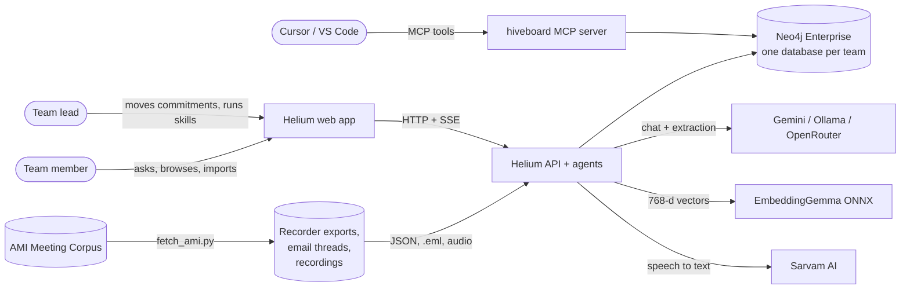
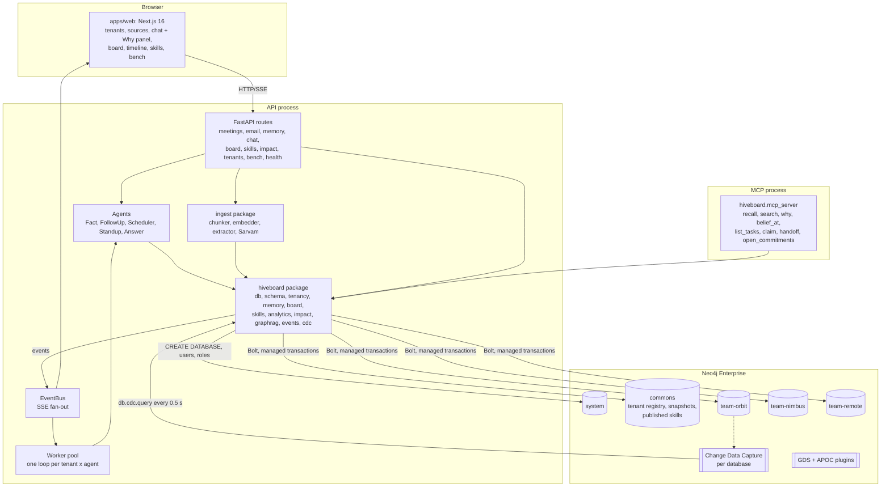
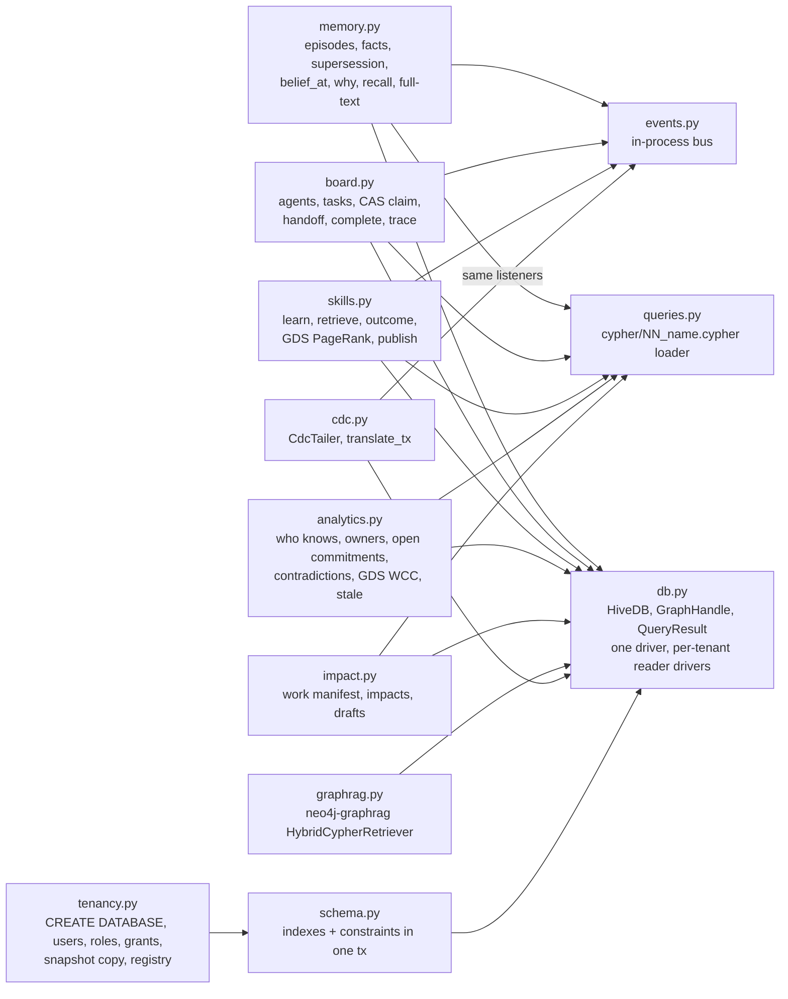
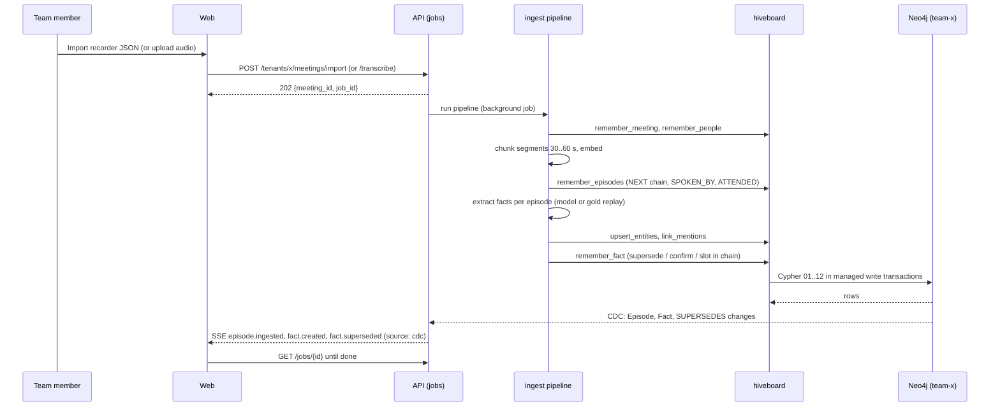
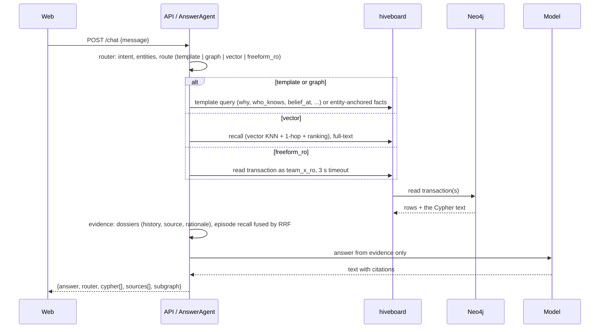
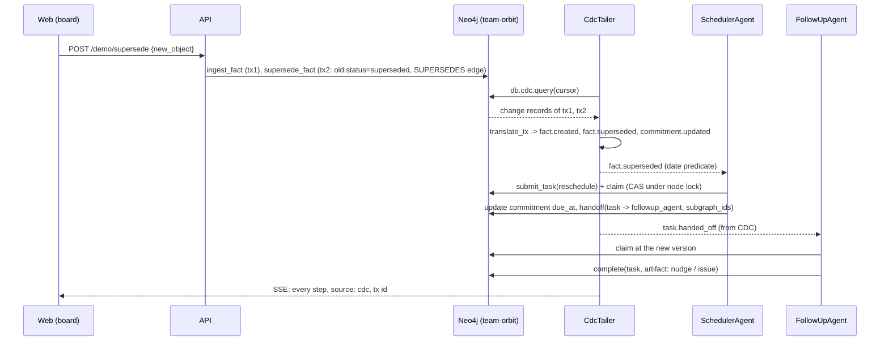
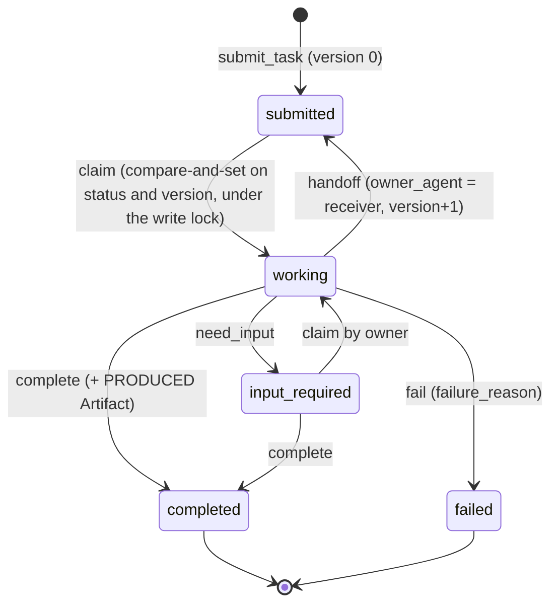
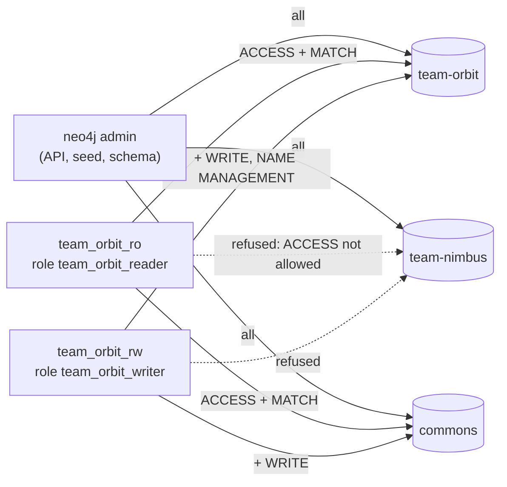
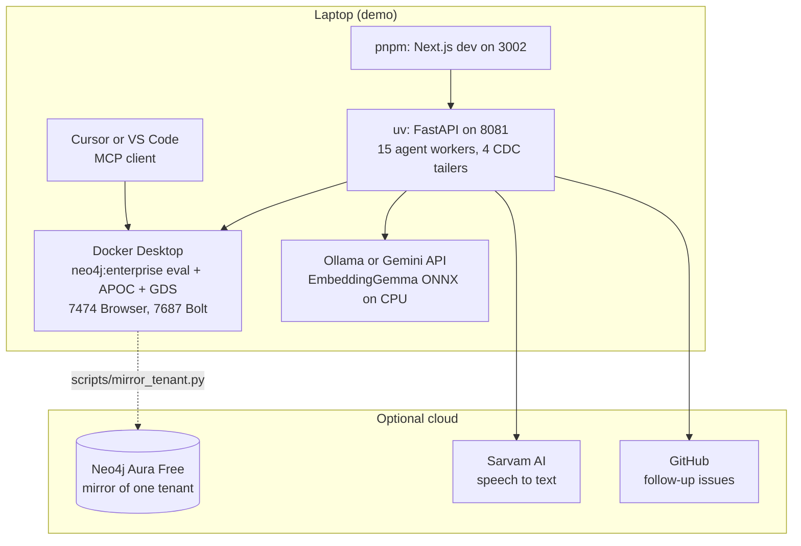

# Architecture

Diagrams are Mermaid and render on GitHub. Levels follow the C4 idea: context, containers, components, then the
runtime views (sequence, state, deployment).

## 1. System context

## 2. Containers

## 3. Components of the substrate (`packages/hiveboard`)

## 4. Runtime views

### 4.1 Import a meeting

### 4.2 Answer a question with provenance

### 4.3 A commitment moves; the agents react through CDC

### 4.4 Task lifecycle (A2A states)

### 4.5 Tenancy and access

## 5. Deployment

Container images: `apps/api/Dockerfile` (python 3.12-slim + uv; port 8000) and `apps/web/Dockerfile`; `docker-compose.yml`
wires `neo4j`, `api` and `web`.

## 6. Design decisions

| Decision | Why | Alternative considered |
|---|---|---|
| One Neo4j database per tenant | the server enforces isolation (RBAC per database), writes never contend across teams, a tenant can be copied or dropped as a unit | a `tenant` property on every node (checked in code, not by the database) |
| Bi-temporal facts with `SUPERSEDES` | "what did we believe on the 10th" and "what changed and why" are first-class queries | overwrite in place (loses history), event sourcing only (no current view) |
| Compare-and-set under the node's write lock | Neo4j locks at the first SET; the version check must run after the lock | `apoc.lock.nodes`, a global lock node, optimistic retry in Python |
| Wake-ups from Change Data Capture | any writer wakes the agents, with a transaction id to trace; no application message bus | in-process bus only (misses MCP and Browser writes), Kafka |
| Ranking inline in Cypher | one round trip per recall; no custom functions to deploy | a user-defined function, ranking in Python |
| Queries as files loaded by name | reviewable, testable, shown verbatim in the Why panel | ORM, query builders |
| GDS projected and dropped inside one query | no projection state to manage between calls; Cypher fallbacks keep Aura Free working | persistent projections, APOC path expansion |
| neo4j-graphrag retriever next to our own recall | the ecosystem's retriever over the same indexes, with our provenance expansion | one retrieval path only |
