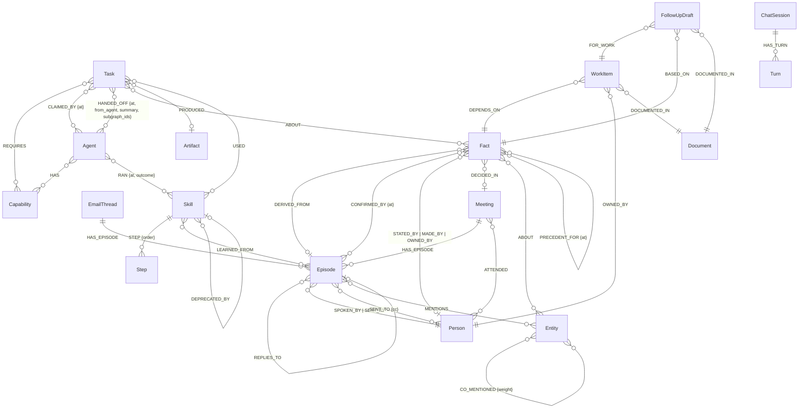
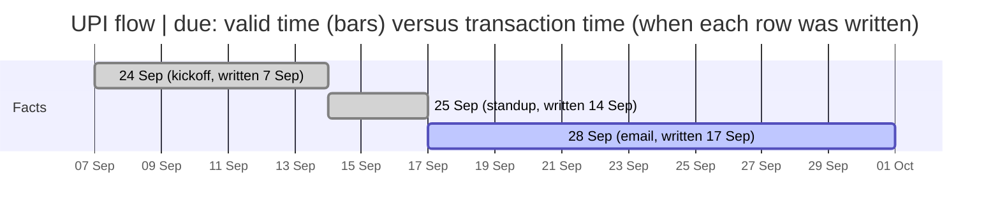

# Data schema

Everything the system stores, with types. Graph data lives in Neo4j (one database per tenant plus `commons`);
files on disk are the ingestion inputs; the API shapes are what the web app and MCP clients see.

Conventions: every timestamp is an epoch millisecond `INTEGER`; ids are strings with a type prefix
(`per_`, `mtg_`, `thr_`, `ep_`, `ent_`, `fact_`, `task_`, `skl_`, `stp_`, `art_`, `snap_`), ULID-ordered when
generated by the system and deterministic (`fact_ep_<meeting>_<seq>_<n>`) when produced by ingestion; embeddings are
`LIST<FLOAT>` of 768 values (EmbeddingGemma, cosine).

## Graph model (per tenant database `team-<slug>`)



### Node labels and properties

| Label | Property | Type | Notes |
|---|---|---|---|
| Person | id | STRING, unique | `spk_*` from the recorder, `per_<slug>` otherwise |
| | name, role, email | STRING | email joins email threads to people |
| Meeting | id | STRING, unique | |
| | title | STRING | |
| | started_at, ended_at | INTEGER ms | |
| | source_uri | STRING | path of the recording for "play at timestamp" |
| EmailThread | id | STRING, unique | |
| | subject | STRING | |
| | started_at | INTEGER ms | |
| Episode | id | STRING, unique | |
| | seq | INTEGER | order inside the container |
| | text | STRING | full-text indexed |
| | t_start, t_end | INTEGER ms | offsets from the meeting start (utterances) |
| | t_occurred | INTEGER ms | absolute time (meeting start + offset, or the email's sent time) |
| | t_ingested | INTEGER ms | transaction time |
| | source_kind | STRING | `utterance`, `email`, `doc_chunk` |
| | message_id | STRING | email message id |
| | embedding | LIST<FLOAT>[768] | vector index `episode_embedding` |
| Entity | id | STRING, unique | `ent_<slug>` |
| | name | STRING, indexed | MERGE key |
| | type | STRING | project, system, person, customer, topic, ... |
| | created_at | INTEGER ms | |
| | embedding | LIST<FLOAT>[768] | vector index `entity_embedding` |
| Fact (+ Decision, + Commitment) | id | STRING, unique | the extra label follows `kind` |
| | kind | STRING | `fact`, `decision`, `commitment` |
| | subject, predicate, object | STRING | predicate from the closed set `due, owner, scope_includes, uses_vendor, uses_pattern, status, requires, customer, decided, lesson` |
| | key | STRING, indexed | `lower(subject|predicate)`: the supersession key |
| | text | STRING | full-text indexed |
| | confidence | FLOAT 0..1 | |
| | status | STRING, indexed | `active`, `superseded`, `retracted` |
| | valid_from, valid_to | INTEGER ms | valid time (when it was true) |
| | created_at, expired_at | INTEGER ms | transaction time (when we learned or unlearned it) |
| | due_at | INTEGER ms | commitments |
| | decided_at | INTEGER ms | decisions |
| | retract_reason | STRING | |
| | embedding | LIST<FLOAT>[768] | vector index `fact_embedding` |
| Task | id | STRING, unique | |
| | kind | STRING | `extract_episode`, `extract`, `record_fact`, `followup`, `nudge`, `reschedule`, `schedule`, `learn_standup`, `standup`, `run_skill`, `question`, `answer`; bench and demo kinds `bench`, `bench_cas`, `demo_double_claim` |
| | status | STRING, indexed | A2A: `submitted`, `working`, `input_required`, `completed`, `failed` |
| | version | INTEGER | the compare-and-set token |
| | owner_agent | STRING | agent id or null |
| | priority | INTEGER | 1..10 |
| | payload | STRING (JSON) | |
| | created_at, updated_at, completed_at | INTEGER ms | |
| | failure_reason, question | STRING | |
| | _lock | INTEGER | bumped to take the write lock before the version check; hidden from API records |
| Agent | id | STRING, unique | `fact_agent`, `followup_agent`, `scheduler_agent`, `standup_agent`, `answer_agent`, MCP or demo agents |
| | name, model | STRING | |
| | last_seen | INTEGER ms | |
| Capability | name | STRING, indexed | `extract`, `followup`, `schedule`, `standup`, `answer`, `demo`, `bench` |
| Skill | id | STRING, unique | |
| | goal | STRING | |
| | version, runs | INTEGER | |
| | success_rate | FLOAT | running mean |
| | status | STRING, indexed | `active`, `deprecated` |
| | created_at, last_run_at, deprecated_at | INTEGER ms | |
| | embedding | LIST<FLOAT>[768] | vector index `skill_embedding` |
| | origin_tenant, origin_id, published_at | STRING, STRING, INTEGER | only in `commons` |
| Step | id | STRING, unique | |
| | order | INTEGER | |
| | tool, args_template, guard | STRING | tool name, JSON template, guard expression |
| Artifact | id | STRING, unique | |
| | kind, uri, text | STRING | `github_issue`, `nudge_message`, `standup_summary`, `summary`, `extraction`, `skill`, `answer`, `demo` |
| | created_at | INTEGER ms | |
| WorkItem | id | STRING, unique | |
| | title, status, rationale | STRING | |
| Document | id | STRING, unique | |
| | title, uri, content | STRING | |
| | synthetic | BOOLEAN | |
| FollowUpDraft | id | STRING, unique | |
| | payload | STRING (JSON) | |
| | created_at | INTEGER ms | |
| ChatSession | id | STRING | |
| | created_at | INTEGER ms | |
| Turn | id, session_id | STRING | `session_id` indexed |
| | role, text, meta | STRING | meta is JSON |
| | t | INTEGER ms | |

`commons` database: `Tenant {slug (indexed), display_name, graph, rw_user, ro_user, created_at}`, `Snapshot {id (unique), tenant (indexed), graph_name, label, taken_at}`, published `Skill` + `Step` as above.

### Relationship properties

| Relationship | Properties |
|---|---|
| SENT_TO | cc: BOOLEAN |
| CO_MENTIONED | weight: INTEGER (co-mention count) |
| SUPERSEDES, PRECEDENT_FOR, CONFIRMED_BY, CLAIMED_BY | at: INTEGER ms |
| HANDED_OFF | at: INTEGER ms, from_agent: STRING, summary: STRING, subgraph_ids: LIST<STRING> |
| RAN | at: INTEGER ms, outcome: STRING (`ok`, `failed`) |
| STEP | order: INTEGER |

### Indexes and constraints (`cypher/00_schema.cypher`, applied in one transaction)

| Kind | Name(s) |
|---|---|
| Unique `id` constraints (17) | `person_id`, `meeting_id`, `emailthread_id`, `episode_id`, `entity_id`, `fact_id`, `decision_id`, `commitment_id`, `task_id`, `agent_id`, `skill_id`, `step_id`, `artifact_id`, `snapshot_id`, `workitem_id`, `document_id`, `followupdraft_id` |
| Range indexes (17) | `person_email`, `meeting_started_at`, `episode_t_occurred`, `episode_source_kind`, `entity_name`, `fact_status`, `fact_valid_from`, `fact_valid_to`, `fact_key`, `commitment_status`, `commitment_due_at`, `task_status`, `capability_name`, `skill_status`, `snapshot_tenant`, `tenant_slug`, `turn_session` |
| Full-text (Lucene) | `episode_text`, `fact_text`, `decision_text` |
| Vector (HNSW, 768-d cosine) | `episode_embedding`, `fact_embedding`, `skill_embedding`, `entity_embedding` |

Database options: `txLogEnrichment: FULL` (CDC). Users and roles per tenant: `team_<slug>_ro` with role `team_<slug>_reader` (ACCESS, MATCH {*} on the tenant database and `commons`), `team_<slug>_rw` with role `team_<slug>_writer` (plus WRITE, NAME MANAGEMENT); home database = the tenant database.

## Bi-temporal semantics



`belief_at(T)` selects `valid_from <= T < valid_to` (null `valid_to` = still true); `known_by = K` adds `created_at <= K`.
A superseded fact keeps its row; a retracted fact is excluded for every T.

## Events (SSE and agent wake-ups)

`{event: STRING, payload: MAP, ts: INTEGER ms, source: 'cdc' | 'writer', tx?: INTEGER, user?: STRING}` with event in
`episode.ingested`, `fact.created`, `fact.superseded`, `commitment.created`, `commitment.updated`, `task.submitted`,
`task.claimed`, `task.handed_off`, `task.completed`, `task.failed`, `task.input_required`, `skill.learned`, `skill.ran`.
Payloads differ by source: the CDC side (`hiveboard/cdc.py`, `translate_tx`) derives them from change records, so `fact.superseded` carries `subject`, `predicate`, `old_object`, `due_at` and `head_changed`, and `task.submitted` always has empty `requires` and `about`; the writer side publishes what the writing function knows (`new_id`/`old_ids` from `hiveboard.memory`, `old_fact_id`/`new_fact_id` from the ingest pipeline). The worker's `superseded_event_to_task` normalises both shapes before the Scheduler sees them.

## File contracts (ingestion inputs)

Recorder export `data/meetings/<slug>.json` (contract: `docs/contracts/recorder-format.md`):

```json
{"version": 1, "note": "optional metadata", "transcription": {"provider": "sarvam", "...": "optional"},
 "meeting": {"id": "mtg_x", "title": "...", "started_at": "ISO-8601", "ended_at": "ISO-8601", "audio_uri": "data/meetings/x.wav"},
 "speakers": [{"id": "spk_x", "name": "...", "role": "..."}],
 "segments": [{"start_ms": 0, "end_ms": 6400, "speaker_id": "spk_x", "text": "..."}]}
```
Segments are ordered, non-overlapping, `end_ms > start_ms`, speaker ids known.

Email thread (`docs/contracts/email-format.md`): `{"version": 1, "thread": {id, subject, started_at}, "people": [{id, name, email}], "messages": [{id, sent_at, from, to[], cc[], in_reply_to, subject, body_text}]}`; `.eml` and `.mbox` uploads are parsed into the same shape.

Roster `data/meetings/<tenant>_roster.json`: `[{id, name, role, email}]`, the join between sources.

Gold labels `data/gold/<slug>.json`: `{"meeting_id" | "thread_id", "items": [{kind, subject, predicate, object, speaker_id, segment_index | message_index, supersedes?: {subject, predicate}, confirms?: {...}, follows_precedent?: {...}}]}`.

Work manifest (`docs/decision-impact.md`): `{"document": {id, title, uri, content, synthetic}, "items": [{id, title, status, owner_id, baseline_fact_id, rationale}]}`.

Bench result `docs/bench/<run>.json`: `{run_id, ts, engine, target, agents, tenants, duration_s, read_p50/p95/p99, write_p50/p95/p99, errors, cas: {attempts, winners, losers}, ops, per_op, cpu, capabilities, client}`.

## API payload types (summary; full routes in `docs/contracts/http-api.md`)

| Type | Fields |
|---|---|
| Tenant | slug, display_name, graph, usage_mb (FLOAT, 0 on Neo4j), nodes, edges, counts {episodes, facts, decisions, commitments, tasks, skills, entities, meetings, threads}, acl {rw_user, ro_user, rules[], isolation} |
| FactView | id, kind, subject, predicate, object, text, confidence, valid_from, valid_to, created_at, expired_at, status, speaker {id, name}, meeting {id, title} \| thread {id, subject}, episode_id, due_at, entities[], source, supersedes, supersedes_ids[], precedent_ids[] |
| Source | kind (`utterance` \| `email`), episode_id, container {id, title \| subject, source_uri, label}, t_start/t_end \| sent_at/message_id |
| Why | node, speaker, meeting, thread, episode, source, entities[], history[], supersedes[], superseded_by[], cypher, subgraph {nodes[{id, label, labels, props}], edges[{source, target, type, props}]} |
| ChatAnswer | answer, session_id, router {intent, entities, route, template}, cypher[], subgraph, sources[], episodes[], model, latency_ms |
| Task | id, kind, status, version, owner_agent, priority, created_at, updated_at, payload, about[], requires[], failure_reason, question |
| Trace | task, events[{t, type, agent, to_agent?, summary?, subgraph_ids?, artifact?, skill?, reason?, question?}], about[], cypher |
| Skill | id, goal, version, runs, success_rate, status, steps[{id, order, tool, args_template, guard}], learned_from[], pagerank |
| SearchResult | q, items[{id, kind, subject, predicate, object, text, score, entities[], speaker, meeting \| thread, episode_id}], cypher, retriever, indexes {vector, fulltext}, ranker, k |
| Health | ok, neo4j {version, databases[], kind, events}, llm {backend, model, native_tools}, embeddings {model, dim, backend, source}, workers[], started_at, error? |

## Configuration (environment)

`NEO4J_URI`, `NEO4J_USER`, `NEO4J_PASSWORD`, `TENANT_RW_PASSWORD`, `TENANT_RO_PASSWORD`, `HELIUM_EVENTS` (`cdc` | `memory`),
`CDC_POLL_S`, `LLM_BACKEND`, `LLM_MODEL`, `LLM_MODEL_SMALL`, `LLM_MAX_TOKENS`, `LLM_TIMEOUT_S`, `GEMINI_API_KEY[_2]`, `OPENROUTER_API_KEY`,
`OLLAMA_BASE_URL`, `EMBED_BACKEND`, `EMBED_MODEL`, `HF_HOME`, `SARVAM_API_KEY`, `SARVAM_STT_MODEL`, `API_HOST`, `API_PORT`, `CORS_ORIGINS`,
`DATA_DIR`, `SEED_TENANTS`, `AUTO_CREATE_TENANTS`, `WORKERS_ENABLED`, `WORKER_POLL_S`, `STANDUP_MIN_MEETINGS`, `GITHUB_TOKEN`,
`GITHUB_DEMO_REPO`, `BENCH_RESULTS_DIR` (all in `apps/api/config.py`); `HIVE_BACKEND` (`neo4j` | `fake`) is read from the process environment.
