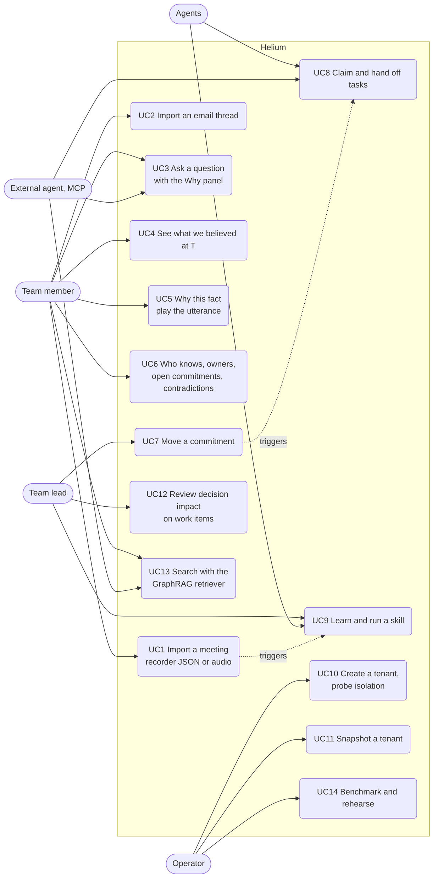

# Use cases

## Actors

| Actor | Kind | Goal |
|---|---|---|
| Team member | human | know what the team decided, when it changed, why, and who to ask |
| Team lead | human | move dates, review the impact of a changed decision, run routines |
| Operator | human | run Neo4j, seed tenants, check the system before a demo |
| FactAgent, FollowUpAgent, SchedulerAgent, StandupAgent, AnswerAgent | software (in the API process) | write memory, react to changes, run routines, answer |
| External agent | software (Cursor or VS Code over MCP) | read the memory, claim and hand off work |
| Neo4j | system | store, index, enforce access, publish the change log |
| Sarvam, model API | external systems | speech to text, extraction and answers |

## Use case diagram

## Use case descriptions

### UC1 Import a meeting
- Actor: team member. Precondition: the tenant exists.
- Main flow: upload a recorder export (or a recording, transcribed by Sarvam); the API answers with a job id; the pipeline writes people, the meeting, episodes (chunked, embedded), entities, facts; supersessions and confirmations are resolved against the active facts; the UI shows the job's stages and counts.
- Postcondition: the meeting is listed with episode and fact counts; events `episode.ingested`, `fact.created`, `fact.superseded` were delivered from the change log; if two meetings share a title prefix, the Standup agent learned a skill (UC9).
- Exceptions: malformed export (400, the contract's validation message); no speech in the recording (422); Sarvam not configured (503).

### UC2 Import an email thread
- Actor: team member. Main flow: upload thread JSON, `.eml` or `.mbox`; the roster maps addresses to people; messages become episodes with `SENT_BY`, `SENT_TO{cc}`, `REPLIES_TO`; facts extracted from an email can supersede facts stated in a meeting (cross-source chains).

### UC3 Ask a question
- Actor: team member or external agent. Main flow: the router classifies the message (why, who knows, owners, open commitments, contradictions, stale decisions, belief at a date, decisions, when, status) and picks a template, an entity-anchored graph walk, hybrid recall, or runs read-only Cypher the user typed; evidence (full supersession history, sources, rationale, episode recall fused by RRF) is assembled; the model answers from the evidence only.
- Postcondition: the answer shows the router decision, every Cypher query that ran, sources with play or open-email links and a subgraph; the turn is stored in the tenant database.
- Exceptions: a write clause in free-form Cypher is rejected; a model error returns the evidence without prose.

### UC4 See what we believed at T
- Actor: team member. Main flow: drag the timeline scrubber (or `GET /belief?t=`); facts with `valid_from <= T < valid_to` are shown; later facts are greyed out. Variation: "as known by K" through the API.

### UC5 Why this fact
- Actor: team member. Main flow: open a fact; the Why panel shows speaker, meeting or thread, the utterance with a play-at-timestamp link (or the email message), the `SUPERSEDES` chain in both directions, precedents and confirmations.

### UC6 Who knows, owners, open commitments, contradictions, stale decisions, clusters
- Actor: team member. Main flow: ask or open the analytics; results come from the numbered templates (`50` to `54`, `61`); clusters use GDS WCC over co-mentioned entities.

### UC7 Move a commitment
- Actor: team lead. Main flow: "Move it to Friday" (or an import with a new date) supersedes the active commitment; the Scheduler agent wakes from the `fact.superseded` change record, claims a `reschedule` task, updates the due date, submits a follow-up and hands it off with the two facts and the owner as the subgraph; the FollowUp agent claims it and produces a nudge or a GitHub issue.
- Postcondition: the board shows the trace (submitted, claimed, handed off, claimed, artifact, completed) with `source: cdc` on every event.

### UC8 Claim and hand off tasks
- Actor: agents and external agents. Main flow: `next_open_task` returns the oldest submitted task the agent's capabilities cover (or one addressed to it); `claim(task, version)` is compare-and-set; `handoff` transfers ownership with a summary and subgraph ids; `complete`, `fail`, `need_input` are owner-only.
- Exceptions: a stale version returns no row (the caller re-reads); 25 concurrent claimants produce exactly one winner.

### UC9 Learn and run a skill
- Actor: Standup agent, team lead. Main flow: after the second standup, a Skill with steps (open commitments per attendee, decisions since the last standup, stale commitments, compose summary) is learned from the two meetings; "Run" retrieves the skill by goal embedding, executes the steps through the agent's tools, posts a standup artifact; "Accept" records the outcome and updates the success rate; the PageRank column comes from GDS.

### UC10 Create a tenant, probe isolation
- Actor: operator. Main flow: `POST /tenants` creates the database (CDC-enriched), schema, users, roles and grants, and the registry row; the tenant card shows the grants; "read nimbus as orbit" runs a query as the tenant's reader against the other database and shows Neo4j's refusal.

### UC11 Snapshot a tenant
- Actor: operator. Main flow: the tenant database is copied into `team-<slug>-snap-<ms>` and a Snapshot node is recorded in `commons`; the timeline lists snapshots.

### UC12 Review decision impact
- Actor: team lead. Main flow: import a work manifest (items with explicit baseline facts and owners); the impact page shows, per item, the baseline fact, the current fact for the same key and the supersession path between them; a follow-up draft is saved only when the graph still matches the reviewed state.

### UC13 Search with the GraphRAG retriever
- Actor: team member or external agent. Main flow: `GET /search?q=` (or the MCP `search` tool) runs `neo4j-graphrag`'s hybrid retriever (vector plus full-text, fused) with the provenance expansion; results carry score, entities, speaker, source and the Cypher.

### UC14 Benchmark and rehearse
- Actor: operator. Main flow: `bench.harness` seeds N tenant databases, runs a mixed load and a compare-and-set race, writes `docs/bench/<run>.json`; `scripts/demo_check.py` runs every demo beat against the live API and prints PASS/FAIL.
